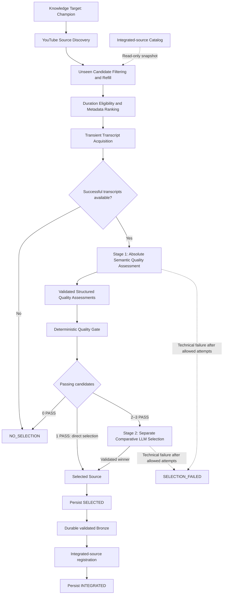
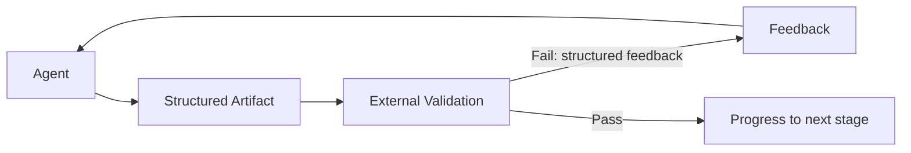
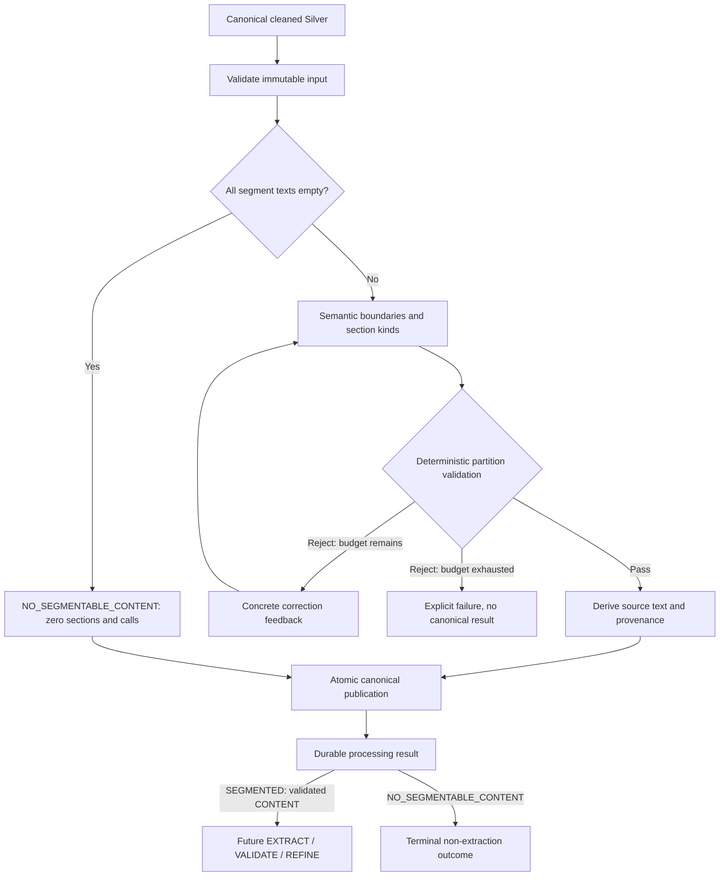

# Agentic Knowledge Preparation for Multi-Hop Retrieval

This project investigates whether query-time latency in agentic multi-hop retrieval can be reduced by shifting part of the knowledge organization upstream into an agentic preparation process.

## Problem

Complex multi-hop questions often require an agent to repeatedly retrieve information and reconstruct relationships between separate pieces of knowledge at query time. This flexibility comes at the cost of increased latency, tool usage and reasoning complexity.

The underlying problem in agentic retrieval over large knowledge bases is therefore not only **how to retrieve relevant information**, but also **how much knowledge organization should happen before a query ever arrives**, **how this knowledge should be organized**, and **how specialized the preparation mechanism needs to be**.

## Research Questions

1. **Does structured agentic knowledge preparation improve multi-hop retrieval relative to simpler preparation strategies or live query-time retrieval?**
2. **If agentic preparation helps, does it require a purpose-built preparation architecture, or can a capable generic agentic preparation harness achieve comparable results?**

The first hypothesis is that unstructured material can be processed before query time through multi-stage agentic knowledge curation into a structured, relation-aware representation. For previously unseen multi-hop questions, this may reduce retrieval calls, tool usage, reasoning complexity and latency while preserving or improving answer quality and groundedness.

The second question asks whether specialized machinery creates measurable value beyond generic intelligent preparation: explicit knowledge contracts, semantic validation, source-level consolidation, provenance constraints, canonical identity, structured Gold integration, deterministic writing, conflict preservation and reusable canonical artifacts. Neither question has been answered experimentally.

## Experimental Domain

To investigate this hypothesis, League of Legends was selected as the experimental domain. It provides a complex and continuously evolving body of knowledge with many interconnected concepts, while a large part of the available expertise exists in unstructured public sources such as educational videos.

This makes the domain useful for studying knowledge preparation: relevant information may be distributed across different sources, multiple sources may cover the same Champion or concept, and new sources may add details without replacing what is already known. Multi-hop questions may require connecting Champion mechanics, situational context, and strategic decisions across these sources.

League of Legends therefore serves as the experimental domain rather than the primary technical purpose of the project.

## Approach

The project does not start from a pre-structured knowledge base. Its preparation pipeline is intended to build and evolve knowledge from public unstructured source material, moving some interpretation and relationship-building work upstream. A structured target catalog identifies what to acquire; it is not the knowledge corpus.

The implemented **Source Acquisition** pipeline discovers, selects and integrates source material into Bronze. **Agentic Knowledge Curation** now includes explicit preparation through canonical one-source knowledge; Gold integration and **Experimental Evaluation** remain planned. These separate architecture views are described below; the end-to-end acquisition/curation system remains incomplete.

The purpose-built **Core Knowledge Pipeline is being completed first**, through canonical Gold integration. Retrieval/answering, baseline implementation and Experimental Evaluation are separate downstream workstreams. Planned comparisons include Fixed-Size RAG, Generic Agentic Preparation, Live Web Search Agent and the purpose-built system. The same-corpus comparison isolates preparation strategy; live Web Search is a separate practical benchmark. See [Experimental Evaluation](#experimental-evaluation).

### Data Sources

| Source | Role |
| --- | --- |
| **Riot Games Data Dragon** | Establishes the authoritative Champion target catalog / target universe. The versioned catalog is committed locally and loaded without a runtime Riot request. It is structured target data, not the main knowledge corpus. |
| **YouTube** | V1 public source pool for educational knowledge contained primarily in unstructured video/transcript content. Discovery also supplies structured video metadata used for candidate collection and ranking. |

### Source Acquisition



Stage 1 assesses each available transcript independently against an absolute minimum standard. The flow is **LLM semantic judgement → structured assessment → deterministic application rules → PASS / REJECT**. Application code derives PASS only when `target_relevant`, `educational_substance`, and `transcript_usable` are true and `noise_dominates` is false. The LLM does not return the final gate decision.

Zero passing candidates produces normal `NO_SELECTION`. One is selected directly, without a comparative call. Two or three invoke a separate relative comparison to select the strongest passing source. Stage 2 receives no Stage-1 assessments, booleans, reason codes, or rationales. Neither semantic stage receives popularity, recency, ranking scores, discovery order, or original shortlist rank; explicit request allowlists preserve this boundary.

Selection uses full available transcript text and retains the original candidate identity and segment timing/provenance internally. An empty acquired set produces `NO_SELECTION` without an LLM call. A technical selection failure produces `SELECTION_FAILED`, never a fallback winner or normal no-selection. Technical caption-acquisition failures abort before source selection. The run service passes only a successfully selected source to the [Bronze integration API](#selected-source-bronze-integration), then records successful integration.

Automated discovery refers to callable components. A manually invoked [run service](#resumable-acquisition-runs) now composes them sequentially with persistent progress. Scheduling remains outside V1.

### Incremental Source Acquisition

Repeated acquisition is intended to find additional previously unseen sources for the same Champion. Integrated-source filtering and resumable acquisition through Bronze persistence and registration are implemented; subsequent knowledge curation remains planned. The run service performs the integration in the following example:

| Logical run | Example |
| --- | --- |
| Run 1 | Source A is selected, then successfully persisted to Bronze and registered as integrated. |
| Run 2 | Integrated Source A is excluded; Source B may be selected and later registered after successful Bronze persistence. |
| Run 3 | Integrated Sources A and B are excluded; Source C may be selected. |

**Selected does not mean integrated.** Discovery, ranking, quality assessment, and selection do not register sources. The run service invokes Bronze integration after persisting selection; the Bronze API registers the source only after successful durable persistence. Unselected or rejected candidates are not added to the catalog by acquisition.

An additional source does not necessarily contribute useful new knowledge. Planned curation may create knowledge, enrich existing knowledge, find overlap, flag conflicts, or make `NO_CHANGE`. It will evolve the existing Gold knowledge rather than rebuild an independent knowledge base for every source. Reusable concepts may emerge from Champion sources; systematic concept-target acquisition remains future scope.

## Current Implementation

The repository implements end-to-end Source Acquisition through transient selection, resumable progress, durable Bronze and source registration, plus explicit Silver cleaning/segmentation, transient extraction, validated-section knowledge and canonical one-source knowledge:

| Implemented capability | Repository evidence |
| --- | --- |
| Versioned Champion target catalog and local validation/loading | [Catalog](data/champion_targets.json), [target loader](league_knowledge_platform/targets.py) |
| Automated YouTube candidate discovery with metadata and continuation cursors | [Discovery](league_knowledge_platform/youtube.py) |
| Persistent SQLite lookup and idempotent registration of successfully integrated source IDs | [Source catalog](league_knowledge_platform/source_catalog.py) |
| Immutable selected-source Bronze JSON, exact segment timing, original provenance and post-persistence registration | [Bronze integration](league_knowledge_platform/bronze.py), [local publication](league_knowledge_platform/_bronze_filesystem.py) |
| Deterministic NFC/whitespace transcript cleaning, versioned canonical Silver, exact Bronze provenance and atomic publication | [Silver cleaning](league_knowledge_platform/silver.py), [API](#silver-transcript-cleaning) |
| Semantic boundary proposals, deterministic partition validation, bounded correction and durable logical-section/empty outcomes | [Segmentation](league_knowledge_platform/segmentation.py), [provider](league_knowledge_platform/deepseek_segmentation.py), [API](#semantic-silver-segmentation) |
| Single-section transient KnowledgeItem proposals, application-owned identity and current-section evidence validation | [Extraction](league_knowledge_platform/extraction.py), [provider](league_knowledge_platform/deepseek_extraction.py), [API](#transient-knowledge-extraction) |
| Five-gate section Judge, full-proposal refinement and atomic reusable validated-section checkpoints | [Validation](league_knowledge_platform/section_validation.py), [checkpoints](league_knowledge_platform/section_knowledge.py), [API](#section-level-semantic-validation) |
| One-source consolidation, exact input accounting, seven-gate validation and reusable canonical source knowledge | [Audit](league_knowledge_platform/source_audit.py), [artifacts](league_knowledge_platform/source_knowledge.py), [API](#source-level-audit-and-refinement) |
| Immutable Gold units, stable identities, source-item references, historical merge links and a strict in-memory codec | [Models](league_knowledge_platform/gold_models.py), [validation](league_knowledge_platform/gold_contract.py), [API](#versioned-gold-contract) |
| Canonical Gold Markdown/metadata pairs, bounded layouts, structural pruning and atomic local snapshot publication | [Documents](league_knowledge_platform/gold_documents.py), [store](league_knowledge_platform/gold_store.py), [API](#canonical-gold-documents) |
| Unseen-source filtering, refill, immutable integrated-ID snapshot, and cross-page deduplication preserving first-seen order | [Collection](league_knowledge_platform/unseen.py) |
| Deterministic popularity/recency ranking, explicit reference time, and configurable duration eligibility through central defaults | [Ranking](league_knowledge_platform/ranking.py), [defaults](league_knowledge_platform/defaults.py) |
| Transient acquisition of timestamped English YouTube captions, manual-English preference, and provider failure handling | [Acquisition](league_knowledge_platform/transcripts.py), [provider adapter](league_knowledge_platform/youtube_caption_provider.py) |
| Absolute semantic quality assessment, deterministic PASS / REJECT, direct or comparative selection, and explicit no-selection/technical-failure outcomes | [Selection service](league_knowledge_platform/source_selection.py), [domain contracts](league_knowledge_platform/selection_models.py) |
| Separate allowlisted semantic requests, configurable DeepSeek adapter, and at most three attempts per semantic stage | [DeepSeek adapter](league_knowledge_platform/deepseek_selection.py), [versioned prompts](league_knowledge_platform/selection_prompts.py) |
| Explicit new/resume operations through Bronze, immutable target snapshots, shared three-attempt budgets, and reconciliation | [Run service](league_knowledge_platform/acquisition_runs.py), [SQLite run state](league_knowledge_platform/run_repository.py), [run contracts](league_knowledge_platform/run_models.py) |
| Centralized non-secret service defaults and offline unit/integration tests using fakes and synthetic HTTP fixtures | [Defaults](league_knowledge_platform/defaults.py), [tests](tests/) |

Collection returns at most 20 unique unseen candidates. Duration is an eligibility filter only; popularity and recency determine ranking. The shortlist contains 0–3 candidates. Caption unavailability is candidate-level and non-fatal; technical provider failures fail the operation without returning a successful partial transcript set.

The run service invokes the Bronze integration API with the original in-memory selected source. Bronze persistence and validation precede catalog registration and the final run-state commit. Discovery, ranking, transcript acquisition and semantic selection do not persist their transient candidates.

The platform as a whole remains in development. Standalone extraction produces transient proposals; section-level validation publishes durable checkpoints, and source audit consolidates them into canonical knowledge for one source. Gold provides model/identity contracts, canonical Markdown/metadata pairs and low-level local snapshot storage. Gold Integration, the semantic Deterministic Writer and retrieval indexing remain planned. Knowledge preparation stages are explicit operations outside acquisition-run orchestration. Fixed-Size RAG, Generic Agentic Preparation, Live Web Search Agent and comparative evaluation are not implemented. Offline tests do not demonstrate live provider availability, semantic model quality or the research hypothesis.

## Planned Agentic Knowledge Curation

The planned curator has two logical AI stages, **Knowledge Extraction** and **Knowledge Integration**, followed by a **Deterministic Writer**. Standalone extraction, section-level validation/refinement and source audit are implemented; complete curation into Gold remains planned within the accepted Knowledge Platform architecture.

Its downstream architecture is **Bronze → deterministic Silver Cleaning → semantic logical segmentation → Knowledge Extraction proposals → section-level semantic validation/checkpoints → Source-Level Audit → SourceKnowledgeArtifact → planned Existing-Knowledge Inspection → Knowledge Integration → Updated Structured Knowledge Base**. Bronze retains the selected raw source. Silver segmentation is the single semantic SEGMENT stage; extraction consumes validated CONTENT sections without segmenting again. Source audit produces one-source knowledge; subsequent Gold processing remains planned. See the separate [curation architecture](docs/architecture.md#knowledge-layers-and-curator).

The standalone [Knowledge Extraction API](#transient-knowledge-extraction) implements EXTRACT and returns transient proposals. The preparation flow includes implemented EXTRACT, section-level VALIDATE and source-wide audit/refinement:

`EXTRACT → VALIDATE → AUDIT/REFINE → VALIDATE → Knowledge Items`

The governing principle is **Agent → Artifact → External Validation → Feedback → Agent**:



Agents produce structured intermediate artifacts. Explicit validators outside the generating agent's decision determine stage pass/fail. Failed validation returns structured feedback for corrective iteration; progression occurs only after validation succeeds. Validation is a control mechanism, not a guarantee of factual correctness.

Knowledge Integration inspects relevant existing Gold knowledge and proposes governed changes while preserving provenance and contradictions. Planned operations are `NO_CHANGE`, `CREATE`, `ENRICH`, `REWRITE`, `MERGE`, `LINK`, and `FLAG_CONFLICT`. The Deterministic Writer applies validated, approved state changes. V1 excludes autonomous destructive deletion. The [Gold contract](#versioned-gold-contract) defines valid structural state and [document storage](#canonical-gold-documents) provides paired persistence; integration frameworks and integration validators remain future work.

## Experimental Evaluation

Both research questions remain open. Baselines and Experimental Evaluation are downstream work, separate from completing the Core Knowledge Pipeline. The intended comparison set is:

| Planned system | Preparation and role |
| --- | --- |
| Purpose-Built Agentic Knowledge Preparation | This repository's complete custom system: unstructured sources → acquisition → Bronze → cleaned Silver → semantic segmentation → extraction → semantic validation → source audit → cross-source Gold integration → canonical Gold → downstream retrieval/answering. The complete system is not yet implemented. |
| Fixed-Size RAG | Conventional fixed-size chunking and standard retrieval over the same controlled source corpus; a simple preparation baseline. |
| Generic Agentic Preparation | A capable general-purpose agent receives the same controlled corpus and a broad knowledge-base-building objective. It may inspect sources, organize/update documents, consolidate information and improve its knowledge base iteratively. It does not receive this project's specialized contracts or preparation architecture. Hermes is a candidate harness, not a mandatory dependency. |
| Live Web Search Agent | A capable agent answers the same evaluation questions using live web search, without a dedicated prepared knowledge base. |

| Comparison group | Planned systems | Purpose |
| --- | --- | --- |
| Controlled knowledge-preparation comparison | Fixed-Size RAG; Generic Agentic Preparation; Purpose-Built Agentic Knowledge Preparation | Isolate preparation strategy using the same curated source corpus and the same previously unseen multi-hop questions. |
| Practical system-level benchmark | Purpose-Built Prepared Knowledge System; Live Web Search Agent | Test the practical value of maintaining prepared knowledge versus searching the open web at query time. This is not a controlled preparation ablation. |

Where possible, the later controlled comparison should hold the answering model, questions, source corpus and applicable downstream retrieval infrastructure constant. The generic preparation agent must not inherit the custom KnowledgeItem contract, section-validation gates, exact source-audit lineage accounting, IntegrationPlan or specialized Gold integration rules: doing so would reproduce the architecture under test.

Live Web Search changes the available information universe, source selection, retrieval mechanism, freshness and potentially source quality. It is a practical system-level benchmark and must be analyzed separately from the controlled same-corpus comparisons.

| Candidate measurement area | Questions for later evaluation design |
| --- | --- |
| Answer quality and groundedness | Does preparation preserve or improve correctness, completeness, source grounding and relevance? |
| Retrieval quality | Is relevant evidence found with adequate precision, recall and source coverage? |
| Query-time efficiency | How do latency, retrieval/tool usage and reasoning complexity differ? |
| Preparation effort | What preparation cost, iterations, validation failures and knowledge changes are required? |

These are candidate measurement areas, not frozen metrics or thresholds. Existing raw knowledge-change requirements remain intact. No comparative results or latency reduction have been demonstrated. The [conceptual evaluation diagram](docs/architecture.md#planned-comparative-evaluation) supplements the preparation architecture.

The later Baseline / Evaluation design freeze will decide chunk size and overlap; embedding model and vector store; reranking; Web Search provider/tool; generic-agent harness and prompts; tool/token budgets and search-call limits; evaluation questions and ground-truth/required-evidence construction; metric definitions and weighting; statistical tests and repetitions; and latency/cost measurement protocol. None is fixed by this framing update.

## Architecture Principles

- **Local-first V1:** Local artifacts and stores, with external source/search and LLM APIs where required. Azure remains a possible future deployment target.
- **Traceable medallion layers:** Bronze retains selected raw sources; Silver remains source-faithful; Gold is the canonical, adaptive Markdown Knowledge Wiki with provenance and visible contradictions.
- **Derived retrieval:** The planned local retrieval index is derived from Gold and synchronized incrementally. A relation-aware representation does not require a new graph database or fixed Gold ontology.
- **Controlled integration:** Transient candidates remain unpersisted; planned curation validates proposed changes before deterministic application.
- **Human-supervised development:** Versioned plans, human design approval, validation, and human PR review/merge follow the [development workflow](docs/development-workflow.md).

See [V1 scope](docs/scope.md), [architecture](docs/architecture.md), and the [architecture decisions](docs/adr/001-medallion-architecture.md) for the accepted design and its history.

## Roadmap / Status

| Status | Work |
| --- | --- |
| Implemented | Champion targets, discovery, integrated-source lookup, unseen collection, ranking, transient transcripts, absolute quality assessment, deterministic gating, conditional comparison, and resumable acquisition runs with offline tests |
| In development | Knowledge Platform overall; acquisition components exist, but the full acquisition/curation pipeline is incomplete |
| Implemented | Selected-source Bronze persistence, post-persistence registration, run integration and offline crash-recovery tests |
| Implemented | Deterministic source-faithful Silver cleaning with durable versioned artifacts |
| Implemented | Semantic logical segmentation, exactly-once structural validation and durable source-faithful processing results |
| Implemented | Independently callable LLM extraction from one validated CONTENT section into transient KnowledgeItem proposals |
| Implemented | Whole-section five-gate semantic validation, bounded full-proposal refinement and reusable validated-section checkpoints |
| Implemented | Source-level audit/refinement, seven-gate validation and canonical SourceKnowledgeArtifact |
| Implemented | Pure versioned Gold models, source-item provenance, historical identity resolution and deterministic serialization |
| Implemented | Canonical Gold document pairs, bounded structure and atomic local snapshot storage |
| Planned — Core completion | Gold Integration, semantic Deterministic Writer, Change Events and raw knowledge-change metrics |
| Planned — Serving | Derived Retrieval / Answering |
| Planned — Baselines | Fixed-Size RAG, Generic Agentic Preparation and Live Web Search Agent |
| Planned — Evaluation | Controlled preparation comparison and separate practical Web Search benchmark |

| Workstream | Priority and scope |
| --- | --- |
| A — Core Knowledge System | Current priority: complete Source → canonical Gold integration. Acquisition, source preparation, the Gold contract and canonical document storage exist; semantic Gold integration and Change Events remain planned. |
| B — Retrieval / Answering | Later: build the serving/query-time path over canonical Gold. Retrieval remains derived/rebuildable and is not implemented. |
| C — Baselines | Later: Fixed-Size RAG, Generic Agentic Preparation and Live Web Search Agent, with the purpose-built system as the system under test. No baseline system is implemented. |
| D — Experimental Evaluation | Later: evaluation dataset → ground truth / required evidence → experiment configuration freeze → runs → metrics → analysis. No comparative results exist. |

The accepted V1 design calls for manually initiated, resumable runs across the Champion catalog, integrating at most one newly selected source per target per logical run. No Champion is permanently complete. Role-specific and reusable knowledge may emerge from sources; a Champion × Role matrix is not required. Dedicated Matchup targets and persistent cross-game user memory remain outside initial V1 scope. A separate League AI Coach may later consume the prepared knowledge.

## Usage and Development

The following APIs are implemented acquisition components. The examples perform live source access only where explicitly indicated; offline tests use injected responses.

## Champion target loading and YouTube discovery

The committed `data/champion_targets.json` catalog is loaded locally with `load_targets()`. Loading validates the complete catalog and raises `TargetLoadError` if it cannot be used. No Riot request is needed at runtime.

Set `YOUTUBE_API_KEY` in the environment before discovery. Keep the key out of repository files and logs. Python 3.10 or newer is required. The discovery API returns one search page per call, including normalized video metadata and a target-bound continuation cursor:

```python
from league_knowledge_platform import YouTubeDiscovery, load_targets

target = load_targets()[0]
discovery = YouTubeDiscovery()
page = discovery.discover_page(target)
# A caller may pass page.next_cursor to discover_page for a later page.
```

Each page enriches its search results with available video metadata. Missing optional fields remain `None`; an upstream failure raises `DiscoveryError` rather than returning a successful page. The separate collector below filters integrated sources and decides whether to request another page. Ranking and transcript evaluation remain outside the discovery and collection components.

## Local source catalog and unseen collection

The source catalog stores only globally integrated YouTube video IDs. A selected source qualifies as integrated after its raw material has been successfully persisted to Bronze and registered. Discovery, collection, ranking, and rejection do not register sources. The Bronze integration API invokes `catalog.register_integrated(video_id)` only after persistence succeeds; repeating that registration is safe and preserves the first registration timestamp. The catalog does not perform or verify Bronze writes itself.

Use SQLite 3.24 or newer with Python's standard-library `sqlite3`. Explicit initialization creates schema version 1; construction and reads never create or migrate a catalog. The database path is caller-controlled; `.state/knowledge_platform.sqlite3` is a suggested local path excluded from Git.

```python
from pathlib import Path
from league_knowledge_platform import (
    YouTubeDiscovery,
    collect_unseen_candidates,
    initialize_source_catalog,
    load_targets,
)

# Explicit setup, separate from read-only collection.
catalog = initialize_source_catalog(Path(".state/knowledge_platform.sqlite3"))
target = load_targets()[0]
result = collect_unseen_candidates(
    target,
    discovery=YouTubeDiscovery(),  # Requires YOUTUBE_API_KEY; performs live discovery.
    catalog_reader=catalog,
)
# result is the input for deterministic ranking, not an ingestion decision.
```

Each collection reads one immutable integrated-ID snapshot before requesting its first page. It excludes integrated IDs, deduplicates across all fetched pages, retains the first candidate's metadata and discovery order, and stops at 20 unique unseen candidates. Overflow is discarded in discovery order. Empty, duplicate-only, or fully integrated pages still trigger refill when a continuation cursor exists. No heuristic page limit or quality threshold is applied.

`UnseenCandidateSet` contains `target_id`, an immutable `candidates` tuple, and `exhausted`; `target_reached` indicates exactly 20 candidates. Normal search exhaustion returns any smaller available set, including an empty set, successfully. Exhaustion means the last successful page had no continuation; it can also be true when the target of 20 is reached.

A discovery failure, including on a later refill page, raises `UnseenCollectionError` rather than returning a successful partial pool. Its `kind`, optional `discovery_failure_kind`, and exception cause distinguish discovery, catalog, and contract failures. Collection does not retry discovery automatically, initialize missing databases, register candidates, or write any persistent state. Missing/corrupt catalogs and unsupported schema versions fail explicitly.

The snapshot is fixed for one collection; it is not a reservation against concurrent source integration. Registration uses short atomic SQL transactions and an idempotent video-ID primary key. The separate Bronze API recovers between durable writes and registration; callers serialize integration operations. Ranking, transcripts, source selection, Bronze/Silver/Gold processing, run state, and scheduling are not implemented by this collector.

Run offline tests with `python -m unittest discover -s tests -v`. They use injected responses and require neither a YouTube key nor network access.

## Deterministic candidate ranking

`rank_candidates()` consumes a completed `UnseenCandidateSet` and returns an immutable `RankedCandidateSet`. Known durations below 3 minutes or above 30 minutes are excluded before ranking; both boundaries are eligible. Unknown duration remains eligible. Duration has no score contribution: a 10-minute and a 25-minute video with otherwise identical ranking metadata receive identical scores.

```python
from datetime import datetime, timezone
from league_knowledge_platform import rank_candidates

# Use one explicit reference time for reproducible evaluation of this collection.
reference_time = datetime(2026, 10, 13, tzinfo=timezone.utc)
shortlist = rank_candidates(result, reference_time=reference_time)
for entry in shortlist.candidates:
    original_video = entry.candidate
    print(original_video.video_id, entry.score)
```

For eligible candidates, popularity is `ln(1 + views) / ln(1 + maximum eligible views)`. All known counts being zero yields zero popularity. Recency is `2 ** (-age_days / 365)`, where age is calculated against the supplied timezone-aware reference time and capped at zero for a future publication date. Reference times are normalized to UTC; a reference time without a timezone is rejected.

The score is 70% popularity plus 30% recency, rounded to 12 decimal places. Missing views or publication dates remain absent and contribute zero; the other signal's weight is not increased. Equal final scores preserve the original collection/discovery order. This is a metadata funnel, not a judgment of educational or semantic quality.

The output contains exactly `min(3, eligible_count)` entries, including none when every video is excluded. Each entry retains the original `CandidateVideo` object, discovery index, both normalized signals, their contributions, and final score. The set records the UTC reference time, immutable scoring configuration, input and eligible counts, and `input_exhausted` from collection. An empty shortlist does not imply search exhaustion or cause discovery/refill. The ranker makes no network, filesystem, or database calls, and does not register sources or persist candidates. Transcript acquisition and semantic source selection are separate downstream components, described below.

Non-secret tunable defaults are centrally discoverable in `league_knowledge_platform/defaults.py`: duration bounds, Top-K, scoring weights, recency half-life, score precision, the existing unseen limit, and discovery page size/timeout. `RankingConfig` consumes the scoring defaults and can be supplied explicitly for reproducible evaluation; it requires positive weights summing to one with popularity stronger than recency. Eligibility limits and Top-K come from the central service defaults. Existing discovery settings retain their established values and override behavior. Secrets such as `YOUTUBE_API_KEY` remain environment/runtime configuration and never belong in the defaults module.

## Transient English caption acquisition

Install the optional provider dependencies in your Python environment:

```shell
python -m pip install -r requirements-transcripts.txt
```

`acquire_transcripts()` consumes the completed `RankedCandidateSet` without changing ranking, identity, metadata, or relative order. It uses our replaceable `CaptionProvider` protocol. `YouTubeCaptionProvider` wraps the pinned `youtube-transcript-api==1.2.4` public SDK and retrieves existing public caption tracks without a YouTube Data API key. It does not translate captions, download audio, or run speech recognition.

```python
from league_knowledge_platform import YouTubeCaptionProvider, acquire_transcripts

# This explicitly performs live caption requests for the supplied shortlist.
# Offline tests inject a fake provider or synthetic HTTP adapter instead.
with YouTubeCaptionProvider() as provider:
    transcripts = acquire_transcripts(shortlist, provider=provider)

for outcome in transcripts.outcomes:
    print(outcome.ranked_candidate.candidate.video_id, outcome.status.value)
# transcripts.transcripts contains only successful transient acquisitions.
```

Manual English captions are preferred over auto-generated English captions across all accepted English locales. Within each caption type the stable preference is `en`, `en-US`, `en-GB`, then other English variants. Matching is case-insensitive and accepts `_` as a locale separator; original language metadata is retained. A valid but empty manual track may fall back to another existing English track. A technical manual-track failure aborts acquisition rather than being hidden by an automatic-track fallback.

Each acquired transcript references the original `RankedCandidate` and retains ordered segments with source position, decoded source text, whitespace-normalized text, and exact `Decimal` start/duration seconds. Empty segments may be removed; substantive content, repeated captions, overlapping times, and explicit zero duration are preserved. Text is not summarized, semantically cleaned, or truncated for model context. The derived `text` property joins normalized segments without replacing their timing/provenance representation.

The SDK adapter uses public `list()` and track `fetch()` interfaces. A narrowly scoped response hook checks source timing before the SDK can replace a missing duration with zero. It cross-checks the public fetch result against the source response; unsupported caption structures or unexpected text/timing transformations fail explicitly. It does not construct caption URLs, parse YouTube pages, or call private SDK parser functions.

For 0–3 input candidates, `TransientTranscriptSet` retains the original shortlist and an explicit `acquired` or `unavailable` outcome for every candidate. No tracks, disabled captions, no acceptable English track, and valid empty caption content are normal unavailability. Acquisition continues, and successful transcripts retain their original relative order: A acquired, B unavailable, C acquired returns A then C. An empty shortlist makes no provider call; all normally unavailable candidates produce a successful empty transcript tuple with their outcomes.

Timeout, network, rate-limit/blocking, applicable authentication/authorization, service, parsing, malformed/incomplete response, and provider-contract errors raise `TranscriptAcquisitionError`. Its `kind`, `video_id`, `shortlist_position`, and `phase` identify the failure without transcript content or provider URLs. Processing stops, and earlier transcripts are never returned as a successful partial set. General SDK retrieval errors are not classified as normal absence.

Caption responses and transcripts remain in memory. There are no transcript files, persistent caches, Bronze writes, or source-catalog mutations. The caller owns the successful result until downstream source comparison is complete; the provider context closes its HTTP session and clears its track handles. Only a later selected winner may enter Bronze through a separate integration stage. Transcript acquisition does not select a winner, invoke an LLM, rediscover sources, refill, or change ranking.

`TranscriptConfig` consumes centralized non-secret defaults: 5-second HTTP connect timeout and 15-second read timeout. Requests are sequential, with no automatic retry of technical failures. These HTTP timeouts do not promise a fixed overall operation duration. Secrets remain environment/runtime configuration, never defaults. The SDK relies on YouTube web interfaces that can change or block requests; offline validation verifies behavior and integration contracts, not live availability.

Run the full offline suite after installing the optional dependencies:

```shell
python -m unittest discover -s tests -v
```

The real SDK tests use synthetic responses through the public HTTP adapter boundary and never fall back to live YouTube. Without the optional dependencies, SDK adapter tests explicitly skip; the existing components and fake-provider acquisition tests remain available. Synthetic fixture text is test data, not persisted acquired candidate content.

## Source quality assessment and selection

`select_source(target, transcripts, capability=...)` consumes a successful `TransientTranscriptSet` and an explicit `ChampionTarget`. `SourceSelectionCapability` separates absolute quality assessment from comparative selection. `DeepSeekSelectionAdapter` is the concrete V1 provider; install its optional HTTP dependencies with `python -m pip install -r requirements-selection.txt`.

Provide `DEEPSEEK_API_KEY` through the environment or explicit runtime injection. `DEEPSEEK_MODEL` may override the central default model; an explicit `DeepSeekSelectionConfig` is also supported. Secrets never belong in defaults. The adapter uses non-thinking inference, temperature 0, JSON output, bounded response sizes, and local schema validation. These settings do not guarantee deterministic or correct semantic judgments.

| Result | Meaning |
| --- | --- |
| `SelectedSource` / `SELECTED` | Exactly one passing source, with the original transcript, identity, timing, gate results, and comparison artifact when applicable. |
| `NoSelection` / `NO_SELECTION` | No acquired transcripts or a completed quality gate that rejected every candidate. |
| `SelectionFailed` / `SELECTION_FAILED` | Technical/model failure prevented selection; no winner is returned. |

The selection service owns retries: at most three total attempts per semantic stage reuse unchanged inputs. A comparative-stage failure does not repeat successful quality assessment or restart discovery, collection, ranking, or transcript acquisition. The outputs and assessments remain transient, with no Bronze writes or source-catalog mutation. Offline domain, synthetic HTTP, and ranker/caption/selection integration tests are included in the existing test command. Installing both optional requirements files includes the caption and selection adapter coverage; without their respective dependencies, those adapter tests explicitly skip.

## Silver transcript cleaning

`clean_bronze_source` reads one canonical Bronze artifact and explicitly publishes one canonical Silver cleaned transcript. It does not invoke acquisition, an LLM, a provider, the source catalog or the run database. Serialize cleaning calls and configure non-overlapping Bronze and Silver roots.

```python
from league_knowledge_platform import BronzeConfig, SilverConfig, clean_bronze_source

result = clean_bronze_source(
    "existing-video-id",  # Use the video ID of an existing canonical Bronze source.
    bronze_config=BronzeConfig(root="data/bronze"),
    silver_config=SilverConfig(root="data/silver"),
)
print(result.video_id, result.path, result.created)
```

The central non-secret `SILVER_ROOT` default is `data/silver`. Silver reuses Bronze's source-centric filename encoding: `youtube/id-<lowercase ASCII hex>.json`. Runtime artifacts are ignored by Git. Neither target nor run context changes source identity.

Cleaning applies exactly `unicodedata.normalize("NFC", source_text)` followed by `" ".join(normalized.split())` to every Bronze segment's original `source_text`. This normalizes whitespace to ordinary spaces, collapses runs and trims boundaries. Repetitions, unusual wording, advertisements, sponsor passages and filler remain. No paraphrasing, punctuation invention, semantic filtering or logical segmentation occurs.

Silver JSON has `schema_version: 1`, `cleaning`, `source`, `bronze`, `acquisition` and `transcript` sections. It copies source/acquisition/track metadata unchanged and retains every segment's original `source_index` and exact decimal timing strings. Empty cleaned segments remain in place; full text joins nonempty segment texts with one space. Raw text and selection assessments remain in immutable Bronze, referenced by canonical relative path and the SHA-256 of its exact bytes.

`cleaning.rule_version: 1` defines the cleaning rules. `cleaning.unicode_version` records informational runtime provenance only: a different Unicode version alone never makes equivalent Silver incompatible. Reprocessing validates the complete artifact and compares all material fields with the result derived from canonical Bronze, excluding only this diagnostic value. Compatible artifacts retain their original bytes and metadata. Material differences or unsupported schema/rule versions fail explicitly without replacement. A future material normalization change requires an explicit new cleaning-rule version; it must not silently redefine version 1.

`decode_silver_artifact` and `validate_silver_artifact` validate the standalone contract. `validate_silver_against_bronze` additionally checks actual derivation and provenance against Bronze. The cleaned artifact contains the complete text, source context, segment order and timing needed by future logical segmentation without another content input. It does not itself create logical sections or knowledge items.

Writes use sibling staging, flushing, validation and non-overwriting atomic publication. Interrupted temporary files are never promoted as valid results. An interruption after publication can leave a complete canonical artifact that is validated and reused on retry. Bronze is read-only throughout; no source registration or run-state transition occurs. Errors distinguish invalid Bronze input, Silver contract failures, integrity conflicts and filesystem failures without including transcript contents.

## Semantic Silver segmentation

`segment_silver_source` explicitly processes one canonical cleaned Silver transcript. It never acquires source material or changes Bronze, Silver, the source catalog or acquisition-run progress. The DeepSeek adapter uses the existing optional dependencies in `requirements-selection.txt` and `DEEPSEEK_API_KEY` from the process environment; `.env` is not loaded automatically.

```python
from league_knowledge_platform import (
    DeepSeekSegmentationAdapter, SegmentationOutcome, segment_silver_source,
    load_segmentation_artifact, content_sections,
)

with DeepSeekSegmentationAdapter() as capability:
    result = segment_silver_source("existing-video-id", capability=capability)

if result.outcome is SegmentationOutcome.SEGMENTED:
    validated = load_segmentation_artifact("existing-video-id")
    extraction_input = content_sections(validated)  # Copied CONTENT view; segment texts are in Silver.
```

The LLM sees only language, the complete ordered segment indices/text and application-generated validation feedback. It returns contiguous endpoint ranges and exactly CONTENT or ADVERTISEMENT, without authoritative text, titles or summaries. Deterministic validation enforces complete exactly-once coverage of the actual sequence, including index gaps, empty segments, repetition and ads. Application code derives section text from Silver and retains exact constituent timing. Section intervals enclose all member starts/ends, including overlapping or nonchronological captions.

Clear sponsor/promotion passages may be ADVERTISEMENT; mixed substantive/promotional or ambiguous material must be CONTENT. Intros, repetition, commentary and low-density explanation are not advertisements merely for appearing less useful. Semantic coherence and classification remain model judgments, not facts proven by structural validation. Ads remain durably stored; `content_sections` returns a separate copied CONTENT view for later extraction. Each returned section includes its `source`, `silver`, `bronze` and `acquisition` context, so its identity and upstream provenance remain available independently of the parent artifact.



One application-owned budget permits at most three capability invocations per explicit processing operation. Network/provider failures, malformed responses and invalid partitions share it; HTTP retries are disabled. Authentication/configuration/context-limit failures stop promptly. Complete input is sent on every attempt. There is no section-size policy, transcript truncation, fixed-size fallback or technical-window segmentation. Truncated output is rejected; a remaining attempt may request a larger response allowance. Provider capacity, response limits and timeouts can still produce explicit failure, never a partial canonical result.

The central `SEGMENTATION_ROOT` default is `data/silver-sections`, with source-centric `youtube/id-<ASCII hex>.json` naming. Configure `SilverConfig`, `BronzeConfig` and `SegmentationConfig` roots separately and serialize calls. Both schema and segmentation contract are version 1. Results retain source/acquisition/track metadata, exact Silver-byte hash/reference, upstream Bronze provenance, section membership/timing and bounded provider/model/prompt/attempt metadata. They omit raw prompts, rejected responses and credentials.

No result means no completed canonical outcome is available. SEGMENTED means successful segmentation. All-empty valid Silver produces durable NO_SEGMENTABLE_CONTENT with zero sections, zero semantic calls and no required credentials. All-advertisement nonempty input is still SEGMENTED even when its CONTENT view is empty. Extraction treats the empty outcome as terminal and performs no second SEGMENT stage.

LLM generation is nondeterministic. The first valid durable result for the exact Silver snapshot and supported contract is canonical; compatible calls reuse its original bytes without inference. A different valid concurrent proposal cannot replace it. Corrupt/incompatible/unsupported artifacts fail without overwrite; there is no force-reprocess API or automatic migration. Model changes alone do not regenerate compatible canonical content. Staged validation and non-overwriting publication reuse existing filesystem mechanisms; interrupted temporary files are never accepted as canonical.

`DeepSeekSegmentationConfig` provides explicit model/timeouts/response bounds; `DEEPSEEK_MODEL` may override the central model default. A small private HTTP/JSON helper is shared with source selection, while prompts, request projection, validation and retries remain separate. See the [semantic Silver decision](docs/adr/011-semantic-silver-segmentation.md). This implements neither extraction/Gold/retrieval nor automatic acquisition-to-preparation orchestration.

## Selected-source Bronze integration

`integrate_selected_source` explicitly consumes an in-memory `SelectedSource`. It does not call discovery, captions, an LLM, Silver or Gold. The run service invokes it directly during a normal target attempt; its stored video ID alone cannot reconstruct a lost transcript. Existing Bronze can instead be recovered without that payload.

```python
from league_knowledge_platform import (
    BronzeConfig, BronzeIntegrationContext, initialize_source_catalog,
    integrate_selected_source,
)

catalog = initialize_source_catalog(".state/knowledge_platform.sqlite3")
# selected is the successful in-memory result from select_source(...).
result = integrate_selected_source(
    selected,
    catalog=catalog,
    config=BronzeConfig(root="data/bronze"),
    context=BronzeIntegrationContext(run_id="optional-logical-run-id"),
)
print(result.video_id, result.path, result.created, result.registered)
```

Keep one Bronze root for every caller sharing a source catalog, and serialize integration calls. The central non-secret `BRONZE_ROOT` default is `data/bronze`. Runtime artifacts are ignored by Git. `canonical_bronze_path(video_id, config)` maps each case-sensitive source ID to `youtube/id-<lowercase ASCII hex>.json`: `A` becomes `id-41.json`, while `a` becomes `id-61.json`, including on case-insensitive Windows filesystems. Target/run identity never changes the path. The canonical YouTube URL is derived from the validated ID.

Each UTF-8 JSON artifact has `schema_version: 1` and `source`, `acquisition`, `selection` and `transcript` sections. It retains available discovery metadata, the original target/run/timestamps, winner-only quality and comparative provenance, provider/track metadata, full normalized transcript text and every acquired segment's raw/normalized text, original index and timing. Decimal seconds are stored as strings without binary float conversion. Unavailable optional metadata remains null. Runtime provider handles, rejected/losing transcripts and other candidates' assessments are omitted. `construct_bronze_artifact`, `decode_bronze_artifact` and `validate_bronze_artifact` expose the same strict contract.

Compatibility requires the same source type, case-sensitive video ID, deterministic URL, language, caption kind, full text, ordered segment indices/text and exact numeric timing. Non-null source track IDs must agree when both encounters supply them. Discovery display metadata, provider/version and target/run/selection context are first-integration snapshots: differences do not rewrite the artifact or independently cause conflicts. An absent track ID is not backfilled. Numerically equivalent decimal representations compare equal; stored bytes stay unchanged.

Persistence stages a complete sibling temporary file, flushes it, validates it and publishes without overwriting an existing destination. Windows uses a write-through native move; POSIX uses non-overwriting hard-link publication and directory synchronization. These guarantees require a supported local filesystem; the native Windows path is tested on NTFS. Storage that does not honor flushes and concurrent/external mutation are outside the guarantee. Directory/publication/durability failures are explicit. Canonical validation and durability confirmation precede `register_integrated`; only its successful completion produces an integration result.

The first durable artifact retains the original provenance even if registration fails. Retry reuses compatible Bronze without rewriting it, then completes idempotent registration; `created` and `registered` distinguish new work from a no-op. Later different target/run/selection context is neither appended nor backfilled. There is no provenance sidecar or historical event store. Material source/transcript conflicts, invalid existing artifacts, or catalog registration without valid Bronze raise `BronzeIntegrityError`. Other errors distinguish contract, filesystem and registration failures; the registration error leaves Bronze available for retry.

Ordinary failures clean their own staging file. After process death, a caller-serialized retry removes only matching temporary names for that source, never promotes temporary content, and never deletes canonical JSON. Tests cover real SQLite failures and fresh-process interruption before/after publication. Atomic visibility and flush ordering do not establish physical power-loss behavior on every storage device.

## Transient knowledge extraction

One complete validated CONTENT section can be processed independently:

```python
from league_knowledge_platform import (
    DeepSeekExtractionAdapter, ExtractionConfig,
    load_extraction_section, extract_knowledge,
)

# These upstream artifacts and this CONTENT section must already exist.
section = load_extraction_section("existing-video-id", "section-000001")
with DeepSeekExtractionAdapter() as capability:
    proposal = extract_knowledge(section, capability=capability,
                                 config=ExtractionConfig(output_limit=8192))
print(proposal.outcome.value, len(proposal.items))
```

`load_extraction_section` reads existing canonical segmentation and cleaned Silver without writing, cleaning or invoking providers. It validates versions, source identity, the exact Silver-byte hash, original section text and membership. Individual segment texts come from Silver because segmentation members retain references and timing rather than separate texts. Immutable input retains the complete section, original source indices/timing and exact segmentation/Silver/Bronze references. `extraction_section_from_artifacts` offers the same validation for callers holding upstream bytes. Unknown or ADVERTISEMENT sections are rejected before extraction; durable NO_SEGMENTABLE_CONTENT supplies no extraction unit. Advertisements remain unchanged upstream.

The provider receives only the complete current segment texts/indices and language. Source content is untrusted data. The extraction objective is high coverage of substantive reusable knowledge, preserving necessary context, conditions, causal explanations, modality, source numbers and conflicting statements. Faithful rephrasing is allowed; external knowledge, source correction, subjective importance filtering and cross-section deduplication are excluded. No second segmentation, transcript truncation or summary fallback occurs.

Provider item drafts have only `statement` and `spans`, each containing `first_source_index` and `last_source_index`. Provider-generated `section_id`, `item_id`, provenance or extra ontology/confidence fields are rejected. Application code validates inclusive spans against the actual current-section sequence, attaches the trusted section ID and assigns proposal-local IDs such as `item-000001`. Final KnowledgeItems have `item_id`, `statement` and `evidence[]`, whose entries contain `section_id` and `spans[]`. Multiple supporting spans are allowed; gaps in numeric source indices do not imply missing segments.

ITEMS_PROPOSED contains one or more items. NO_KNOWLEDGE_PROPOSED contains zero items and is a normal **proposal**, not a technical failure or a final finding that knowledge is absent. Both remain transient and semantically unaccepted. Structural validation checks schema, outcome/count consistency, IDs, exact duplicate statements and current-section evidence references; it cannot prove faithfulness, completeness, atomicity, context preservation, semantic deduplication or minimal supporting evidence. Those checks and feedback-guided refinement belong to the separate implemented whole-section semantic Validator, including for zero-item proposals. The separate source-audit API then consolidates validated checkpoints; Gold integration remains planned.

Every explicit extraction operation invokes its capability once. The DeepSeek adapter has no HTTP retries. Invalid output, context/output limits, authentication, network and provider failures are explicit and never converted into an empty or partial successful proposal. Callers can invoke the same section again; generation is nondeterministic and there is no canonical reuse, cache, first-result preference or extraction persistence. The full section and returned proposal form the separate Validator boundary; this API implements no semantic feedback loop or source orchestration.

Configure the output allowance with `ExtractionConfig`; `DeepSeekExtractionConfig` controls model, timeouts and response-byte limit. Non-secret defaults are centralized; credentials use runtime `DEEPSEEK_API_KEY` and the existing `DEEPSEEK_MODEL` override. The API does not load `.env` automatically. Use independent adapter sessions for any later concurrent section calls. No SQL, catalog registration, Bronze/Silver mutation, Gold writing, queues or retrieval work occurs. See the [transient extraction decision](docs/adr/012-transient-knowledge-extraction.md).

## Section-level semantic validation

One complete CONTENT section and its proposal can be judged, refined and checkpointed independently:

```python
from league_knowledge_platform import (
    DeepSeekExtractionAdapter, DeepSeekSectionJudgeAdapter,
    process_section_knowledge, load_validated_section_knowledge,
)

# Existing Silver and segmentation artifacts are required.
with DeepSeekExtractionAdapter() as extractor, DeepSeekSectionJudgeAdapter() as judge:
    result = process_section_knowledge(
        "existing-video-id", "section-000001",
        extraction_capability=extractor, judge_capability=judge,
    )
print(result.created, result.checkpoint.semantic_rounds_used)

# Read-only inspection needs no provider. Reprocessing a compatible checkpoint
# also needs no capabilities or credentials and makes zero LLM calls.
checkpoint = load_validated_section_knowledge("existing-video-id", "section-000001")
reused = process_section_knowledge("existing-video-id", "section-000001")
```

The service loads the complete validated upstream section and checks source/section identity, exact segmentation/Silver hashes, transitive Bronze provenance and proposal compatibility. An optional `initial_proposal` can supply an existing structurally valid extraction result instead of invoking initial extraction. Advertisements and NO_SEGMENTABLE_CONTENT are not processing units. No upstream artifact is rewritten.

The Judge receives all current items and their actual evidence alongside the complete section. Exactly five gates return PASS or FAIL: FAITHFULNESS, COMPLETENESS, ATOMICITY, CONTEXT_PRESERVATION and DUPLICATION. Application code derives PASS only from five PASS verdicts. Strict output validation rejects missing/extra gates, scores, overall overrides, invalid feedback references and rewritten-item fields. Source text, proposed statements and feedback remain untrusted JSON data rather than instructions.

Faithfulness tolerates semantic paraphrasing, compression and abstraction rather than enforcing wording equality. Completeness concerns all substantive reusable knowledge, not every sentence, repetition or filler. Atomicity retains coherent rules with necessary conditions and causal explanations. Context preservation and within-section duplication are explicit gates; cited evidence must actually support the complete claim. The Judge diagnoses with actionable reasons, affected local IDs and source spans; it does not correct source facts or rewrite knowledge itself.

After REJECT, extraction receives the original complete section, previous complete proposal and structured feedback and returns a complete replacement. There are no item-level patches. The optional refinement path has a separate prompt version; ordinary standalone extraction retains its existing prompt, request projection and single-invocation behavior. Refined provider drafts still contain only statements and spans, with section identity and local IDs supplied by application code.

At most three **completed semantic rounds** occur per explicit operation. A round counts only after a structurally valid proposal and Judge response both exist. A valid REJECT consumes one round; PASS in round 1, 2 or 3 succeeds. Provider/network/schema/authentication/context/output failures abort explicitly without consuming the failed round. They never trigger hidden transport, Judge or extraction retries. Three REJECTs raise SECTION_VALIDATION_FAILED, with no lowered threshold, fallback knowledge or successful checkpoint. Errors expose the completed-round count; failed-loop progress is not persisted or resumed automatically.

Both item-bearing and NO_KNOWLEDGE_PROPOSED proposals undergo all five gates. Accepted zero-item section knowledge is a durable reviewed result, distinct from unprocessed input, technical failure, exhausted validation and upstream NO_SEGMENTABLE_CONTENT. Acceptance is the Judge's semantic judgment, not an objective guarantee of truth or completeness. Automated offline fixtures verify contracts and control flow, not live semantic accuracy.

Successful checkpoints use schema 1 / validation contract 1 under `data/validated-sections/youtube/id-<ASCII hex>/section-000001.json`, excluded from Git. They retain accepted KnowledgeItems, exact upstream references, extraction/Judge metadata, completed rounds and gate diagnoses without duplicating transcripts or rejected proposal text. The first compatible durable result wins. Reuse validates compatibility and makes no LLM calls; corrupt/incompatible artifacts or changed upstream hashes/contracts fail without overwrite. Model configuration alone does not regenerate compatible knowledge.

Publication uses owned unique staging, flush/validation, atomic non-overwriting publication and final revalidation. A compatible racing winner is reused; same-section races can duplicate transient provider work. An operation cleans only its own temporary file; crash leftovers are ignored, not promoted or swept while other operations may run. `operation_rounds_used` describes this call; the checkpoint's `semantic_rounds_used` describes its original accepted history. `load_validated_section_knowledge` only reads; processing also confirms durability before returning success.

`SectionValidationConfig` controls the independent output root, maximum rounds (never above three) and Judge output allowance. `DeepSeekSectionJudgeConfig` controls model, timeouts and response-byte limits. Non-secret defaults are centralized; runtime credentials follow the existing DeepSeek convention. Complete input is never truncated or re-segmented to fit provider capacity. Use independent provider sessions for later section concurrency. Source-wide audit is a separate implemented API; Gold integration, retrieval and queues/workers remain outside this API. See [validated-section decision](docs/adr/013-validated-section-knowledge.md).

## Source-level audit and refinement

After every CONTENT section has a compatible successful section checkpoint, `process_source_knowledge()` consolidates all validated items from exactly one source. Missing, failed or incompatible required checkpoints prevent processing; ADVERTISEMENT sections are excluded. This explicit operation does not invoke extraction, section validation, acquisition or Gold integration.

The following example makes **live DeepSeek calls** when a compatible source artifact does not already exist. It requires existing upstream artifacts and the runtime `DEEPSEEK_API_KEY`:

```python
from league_knowledge_platform import (
    DeepSeekSourceAuditAdapter, DeepSeekSourceValidatorAdapter,
    load_source_knowledge, process_source_knowledge,
)

with DeepSeekSourceAuditAdapter() as agent, DeepSeekSourceValidatorAdapter() as validator:
    result = process_source_knowledge(
        "an-existing-video-id",
        audit_capability=agent,
        validator_capability=validator,
    )

accepted = load_source_knowledge("an-existing-video-id")  # Read-only; no providers.
reused = process_source_knowledge("an-existing-video-id")  # Compatible reuse: zero calls.
```

The Audit Agent returns a complete candidate, not patches. Each validated input must appear exactly once through `derived_from`: many inputs may consolidate into one output, but one input cannot split into multiple outputs or disappear. Application code assigns artifact-local item/conflict IDs and preserves the exact contributing evidence union. It does not accept model-authored hashes, upstream provenance or new evidence. Contradictory statements remain separate with explicit conflict references; no winner or global truth is selected.

The separate Validator checks seven binary gates: SOURCE_FAITHFULNESS, FULL_INPUT_COVERAGE, NO_KNOWLEDGE_LOSS, CROSS_SECTION_DEDUPLICATION, COHERENCE_ATOMICITY, CONFLICT_PRESERVATION and PROVENANCE_INTEGRITY. Application code derives PASS only from all seven PASS verdicts. REJECT returns original inputs, the complete previous candidate and actionable feedback for a complete replacement. Only a valid candidate plus valid completed evaluation consumes a semantic round, with at most three per explicit operation. Operational failures abort without consuming the failed round; three REJECTs raise `SOURCE_AUDIT_FAILED`. There are no hidden HTTP retries, partial-source windows, truncation or fallback knowledge. A diagnosed upstream coverage defect fails explicitly for upstream review; it is never silently repaired by extracting new knowledge.

PASS atomically publishes a versioned `SourceKnowledgeArtifact` under the configurable `data/source-knowledge` root. Outcomes are KNOWLEDGE_AVAILABLE or NO_SOURCE_KNOWLEDGE. Empty validated input constructs an empty candidate deterministically without calling the Audit Agent; the Validator still runs before persistence. Fully verified ads-only or upstream NO_SEGMENTABLE_CONTENT sources can produce the empty source outcome, retaining the distinct upstream outcome and no invented items.

The first compatible durable artifact is canonical. Reuse checks supported schema/audit-contract versions and exact upstream state, including every required checkpoint hash, with zero provider calls or credentials. Recorded model/prompt versions are audit metadata and do not themselves invalidate compatibility; a materially changed semantic contract requires a new source-audit contract version. Corrupt, changed or incompatible artifacts fail without replacement. Same-source races preserve the first compatible winner using owned staging files; crash leftovers are ignored. Failed-loop progress is transient.

`SourceAuditConfig` controls the output root, maximum rounds and separate Agent/Validator output allowances; `DeepSeekSourceAuditConfig` controls model, timeouts and response limits. Non-secret values remain in `defaults.py`. Whole-source capacity failures remain explicit. This artifact contains accepted knowledge for one source, not integrated Gold, global IDs, Gold paths or retrieval metadata. The Gold contract and document storage are available separately; semantic integration and Retrieval remain planned. See the [source-audit decision](docs/adr/014-source-knowledge-audit.md).

## Versioned Gold contract

The [Gold models](league_knowledge_platform/gold_models.py) and [contract API](league_knowledge_platform/gold_contract.py) define structural state in memory. A `SourceKnowledgeItem` belongs to one source artifact. A `GoldKnowledgeUnit` represents integrated knowledge supported by one or more source items; neither is a Markdown document or a Retrieval document. Future Integration decides content and changes. The separate [document layer](#canonical-gold-documents) owns the canonical readable Markdown plus structured metadata pair; the in-memory codec below writes no files and creates no separate canonical store.

```python
from league_knowledge_platform import (
    GoldContractState, decode_gold_state, encode_gold_state, validate_gold_state,
)

empty_gold = GoldContractState(schema_version=1, contract_version=1)
validate_gold_state(empty_gold)
assert decode_gold_state(encode_gold_state(empty_gold)) == empty_gold
```

`GoldKnowledgeUnit` contains `knowledge_id`, nonempty `content`, nonempty `provenance`, `status`, optional `relations` and `merged_into`. `new_knowledge_id()` allocates `gku-` plus UUID4 hex independently of content or placement; validation never allocates or replaces identity. Supply the complete loaded state across documents to detect duplicate IDs and missing targets. Units can move or retain an ID across compatible content replacements; semantic identity decisions remain outside this validator.

Status is `ACTIVE` or `MERGED`. A merged record retains content/provenance and points to a different existing ID; chains must terminate at ACTIVE without cycles. `get_gold_unit()` returns the historical record; `resolve_knowledge_id()` follows its explicit survivor links. These functions perform no merge, deletion or survivor selection. Only `related_to` and `contradicts` relations are supported. Duplicate entries, literal self-edges and unknown complete-state targets fail explicitly. Relations to historical IDs remain unchanged; resolution does not rewrite them or choose a truth winner.

Each `GoldProvenance` identifies an artifact-local source item through `GoldSourceArtifactReference`: source type/ID, root-relative artifact path, exact-byte SHA-256 and source schema/audit versions. Multiple sources/items are allowed; exact duplicate contributions are rejected. `validate_gold_state()` checks reference structure. `validate_gold_provenance(state, source_items_by_artifact=...)` additionally checks membership against a complete caller-verified mapping of artifact references to `frozenset` item IDs, prepared through authoritative source readers and exact artifact hashes. The mapping itself is not proof of evidence validity. Gold does not reload, copy or revalidate upstream payloads, and structural success is not semantic acceptance or proof of source truth.

Schema and contract versions are distinct from stable knowledge identity and `GoldDocumentVersion(document_id, document_version)`. The latter supplies identity/version values consumed by the document layer; this pure API performs no document-version increment or placement. Unknown fields, duplicate JSON keys, malformed references and unsupported Gold versions are rejected. Constructors use frozen dataclasses/tuples; collection ordering normalizes deterministically while duplicates fail. JSON bytes use strict UTF-8, sorted keys/collections and a terminal newline, preserving content exactly without text normalization.

The pure contract has no fixed League ontology, embeddings, retrieval scores, IntegrationPlan, document writer, event store or provider calls. The separate document layer supplies bounded Entity → Document/Domain → Topic → GoldKnowledgeUnit organization; identity does not depend on placement. Gold Markdown plus metadata is canonical, while Retrieval remains a planned rebuildable projection. A semantic unit may later yield one or more Retrieval documents without changing Gold.

## Canonical Gold documents

`GoldDocument` pairs readable Markdown with strict machine metadata. Both are required. Documents have stable `document_id` and independent `document_version`; topics organize multiple ACTIVE units addressed by existing `knowledge_id` markers. Units, headings, files and future Retrieval documents are distinct. Entity/domain keys are generic, with no exhaustive League ontology.

```python
from league_knowledge_platform import GoldConfig, initialize_gold_store, load_gold_snapshot

config = GoldConfig()  # non-secret default: data/gold
initialize_gold_store(config)  # explicit empty initialization; no seed documents
loaded = load_gold_snapshot(config)  # read-only; validates complete selected state
```

`normalize_gold_structure(state, proposed_layout)` constructs canonical organization from caller-supplied complete units and `GoldDocumentLayout` values. It places each ACTIVE unit exactly once and prunes empty topics/documents. Zero-document Gold is valid. MERGED records retain complete content/provenance/links in the metadata of the resolved ACTIVE survivor's document, without requiring empty containers. Pruning never deletes knowledge or Change Event history.

`render_gold_document` and `encode_gold_document_metadata` deterministically produce the pair. ACTIVE content lives in Markdown; metadata holds exact content hashes, context, source-item provenance and relations. Reversible literal-text encoding preserves exact Unicode and whitespace and prevents marker-like source text from becoming syntax. `decode_gold_document_pair` checks the managed template and local pair; `validate_gold_snapshot` supplies complete cross-document identity/reference validation. Contradictions coexist without selecting a winner. The [synthetic fixture](tests/fixtures/gold_documents/laning.md) demonstrates several units/topics; its [metadata](tests/fixtures/gold_documents/laning.meta.json) is required for canonical loading.

`stage_gold_snapshot(snapshot, config=config, base=loaded.reference)` writes a fresh unselected snapshot. `publish_gold_snapshot(staged, config=config, expected_base=loaded.reference)` checks versions/identities and atomically selects complete pairs. An optional trusted application `routes` mapping on staging supports relocation. Readers use one selector and immutable files; stale bases fail. Unchanged logical documents retain versions, changed documents require a higher version, and physical relocation alone does not replace identity or increase the content version.

The store uses `CURRENT.json` and hash-checked manifests under `snapshots/<storage-id>/`. Interrupted staging stays unselected. A publication error after selector replacement can leave the new complete state visible; reload to determine the outcome. Missing/corrupt canonical files fail explicitly. There is no automatic repair, snapshot cleanup or history query. Paths are application-owned, validated against traversal/aliases/collisions and checked for symlink/junction escape. Local filesystem ownership is required.

These are structural storage primitives. Source-to-Gold synthesis, semantic Writer operations, coordinated Gold/Change Event publication, index synchronization and automatic orchestration remain planned. Future coordination must stage Gold without independently publishing it ahead of required Change Events. See the [canonical-document decision](docs/adr/015-canonical-gold-documents.md).

## Resumable acquisition runs

`AcquisitionRunService` composes the existing components sequentially. `start_new_run()` creates a fresh UUID and persists every target from the current validated catalog. `resume_run(run_id)` requires an existing ID and uses only that run's original target data. It never guesses the latest run or loads a newer catalog to change an existing run.

The run database copies Champion ID, Riot key, name and order together with catalog schema/roster versions, generation time, source provenance and a canonical snapshot hash. Additions, removals and metadata changes affect subsequent new runs only. Resume remains possible without the original catalog file. `load_catalog()` exposes the complete immutable catalog; `load_targets()` retains its existing tuple API and validation behavior.

Use a separate local file for run state. Construction is inert; `initialize_run_repository()` explicitly creates or validates run schema version 2. Existing v1 databases require the explicit backed-up migration described below. The integrated-source catalog must already be initialized separately as shown above. The following example performs **live acquisition**, including provider calls for the run targets, and requires the optional caption/selection dependencies and runtime credentials:

```python
from pathlib import Path
from league_knowledge_platform import (
    AcquisitionRunService, DeepSeekSelectionAdapter, SQLiteSourceCatalog,
    YouTubeCaptionProvider, YouTubeDiscovery, initialize_run_repository,
)

state = initialize_run_repository(Path(".state/acquisition-runs.sqlite3"))
sources = SQLiteSourceCatalog(Path(".state/knowledge_platform.sqlite3"))
with YouTubeCaptionProvider() as captions, DeepSeekSelectionAdapter() as selection:
    service = AcquisitionRunService(
        state, discovery=YouTubeDiscovery(), catalog_reader=sources,
        caption_provider=captions, selection_capability=selection,
    )
    summary = service.start_new_run()  # Explicitly create and process a new run.
    # Alternatively: summary = service.resume_run("an-existing-run-id")
    targets = state.list_targets(summary.run_id)
```

Run IDs remain in `acquisition_runs` after interruption and can be inspected before explicitly choosing one to resume. `get_run()`, `list_targets()` and `summary()` read persisted snapshots. `service.inspect_run(run_id)` additionally recovers interrupted state under the execution guard, without provider calls or another target attempt.

Target states are `PENDING`, `RUNNING`, `SELECTED`, `INTEGRATED`, `NO_SELECTION` and `FAILED`. A short committed transition to `RUNNING` consumes one target attempt before active work begins. Normal discovery through Bronze and registration uses one attempt total. Registration-only recovery on a later resume consumes another attempt from the same central maximum of three; component retries do not increment it. `SELECTED` is intermediate. `INTEGRATED` and `NO_SELECTION` are terminal. Each invocation makes one pass, continuing to later Champions after target-local failure. Unexpected target-local errors become sanitized failure codes; unsafe run/catalog storage failures abort explicitly.

Run status is `ACTIVE`, `RESUMABLE`, `COMPLETED` or `COMPLETED_WITH_FAILURES`. `COMPLETED` requires every original target to be `INTEGRATED` or `NO_SELECTION`; all-terminal outcomes containing exhausted technical failures produce `COMPLETED_WITH_FAILURES`. Pending, retryable or unresolved selected work keeps the run resumable. Summaries include separate `integrated` and intermediate `selected` counts. Summaries derive counts from persisted targets. A stored `ACTIVE` after process death is not proof of a live executor: inspection/resume recovers stale `RUNNING` as `FAILED / ORCHESTRATION / INTERRUPTED` without increasing its existing count. An interrupted third attempt is exhausted for active processing. A selected identity is retained so an already completed durable integration can still be passively repaired.

A small nonblocking local OS guard prevents overlapping invocations against the same run database and releases on process exit; contention raises `RunBusyError`. Keep the database and guard on a local filesystem and do not delete the `.lock` file while in use. It is not a lease, heartbeat, distributed lock or SQLite transaction. Provider calls hold no run-state SQL transaction. Before repeating acquisition, resume reconciles any persisted selected identity against Bronze and the catalog. Valid Bronze plus existing registration repairs the same source to `INTEGRATED` without provider calls, registration calls or another attempt, including at count three. Valid Bronze without registration requires a newly claimed registration-only attempt. Missing Bronze permits a new whole acquisition attempt only while budget remains. Corrupt/incompatible Bronze aborts explicitly instead of triggering rediscovery. An interrupted final run-state commit cannot cause a second source to be selected after durable integration.

Run state persists selected video identity/method or no-selection/failure codes and timestamps, never transcript payloads or model responses. **SELECTED remains distinct from INTEGRATED**: the service commits `SELECTED`, passes the original in-memory `SelectedSource` and stored run/target context to Bronze, then commits `INTEGRATED` only after Bronze and registration succeed. Interrupted registration claims stay consumed; no fourth active attempt is allowed. The run database cannot reconstruct lost transcripts. Knowledge-change analytics, curation and scheduling remain outside this service.


### Existing Bronze recovery

`inspect_existing_bronze(video_id, catalog=..., config=...)` strictly validates canonical Bronze and reads registration state. It returns `None` only when both Bronze and registration are absent. It performs no writes or registration. `recover_existing_bronze(...)` revalidates existing Bronze, confirms durability and idempotently registers the source without the original `SelectedSource`, rewriting bytes or reconstructing provenance. Standalone callers must serialize recovery; the run service owns its bounded attempt claims before active recovery.

### Explicit run-state migration

Existing run schema v1 is rejected by normal initialization/use. With no executor running, explicitly migrate it using a separate new backup path:

```python
from league_knowledge_platform import migrate_run_repository_v1_to_v2

state = migrate_run_repository_v1_to_v2(
    ".state/acquisition-runs.sqlite3",
    backup_path=".state/acquisition-runs-v1.backup.sqlite3",
)
```

Migration validates the known v1 schema and original snapshots, creates and checks a non-overwriting SQLite backup, then transactionally copies targets into the extended schema and recreates their constraints/triggers. Failure rolls back schema/data changes; the verified backup remains available. Unknown/modified schemas fail explicitly, and existing backup files are never overwritten. This is a single supported migration, not an automatic database reset.

Legacy `SELECTED` records retain their source identity, method and consumed attempts, become unresolved intermediate work, and use their previous outcome time as the selection timestamp. Previously completed runs containing them become resumable. Resume reconciles existing durable state or uses remaining budget; migration does not assume integration, reset counters or reconstruct transcripts. Catalog membership/provenance and snapshot hashes are preserved. Bronze and Source Catalog schema versions remain unchanged.

Retain the backup. Reverting code and restoring it is suitable before new active processing; after new integrations, do not blindly restore an older progress database without accounting for the newer durable state.
