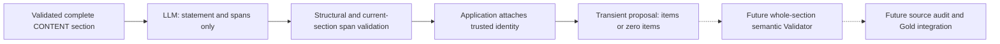

# ADR 012: Transient section-level knowledge extraction

**Status:** Accepted

## Context

The single [semantic Silver segmentation stage](011-semantic-silver-segmentation.md) retains CONTENT and ADVERTISEMENT sections with source provenance. Knowledge extraction needs to propose reusable statements without confusing structurally valid model output with semantically accepted knowledge or canonical Gold.

## Decision

Expose an independently callable operation for one complete validated CONTENT section. Read canonical segmentation and cleaned Silver, validate their exact-byte provenance and reconstruct the original member texts from Silver. Do not segment again or send advertisements to extraction.

An LLM proposes statements and inclusive source-index spans only. Application code validates the spans against the current section, attaches its trusted section identity and assigns local item IDs. The model cannot supply section identity or upstream provenance. KnowledgeItems contain only local item_id, statement and evidence entries with section_id and spans; no fixed semantic ontology or confidence score is introduced.

Prompt for high coverage, faithful abstraction, necessary context, conditions, causal reasoning, modality, source numbers and conflicts. Avoid importance filtering and within-section duplicate knowledge. Deterministic structural checks cannot establish these semantic properties; whole-section semantic validation, feedback/refinement and later source audit remain separate future stages.

Return transient ITEMS_PROPOSED or zero-item NO_KNOWLEDGE_PROPOSED. Both remain unaccepted proposals, including empty proposals that still require later Completeness validation. Neither is canonical knowledge. Upstream NO_SEGMENTABLE_CONTENT remains a distinct terminal non-extraction outcome.

One explicit extraction operation makes one capability invocation, with no HTTP retries or hidden correction loop. Failures return no partial successful result. Repeated calls may differ and receive no first-result or canonical-reuse preference. No extraction files, database state or source-level orchestration are added.

## Consequences

The full section and proposal remain available together for future validation. Evidence resolves to exact immutable upstream inputs and timing transitively. Generation remains nondeterministic, and valid references do not establish semantic support. Provider/resource limits fail explicitly without truncation or fallback segmentation. Existing source selection and segmentation keep their own provider contracts and retry ownership; only the existing HTTP/JSON transport is reused.
