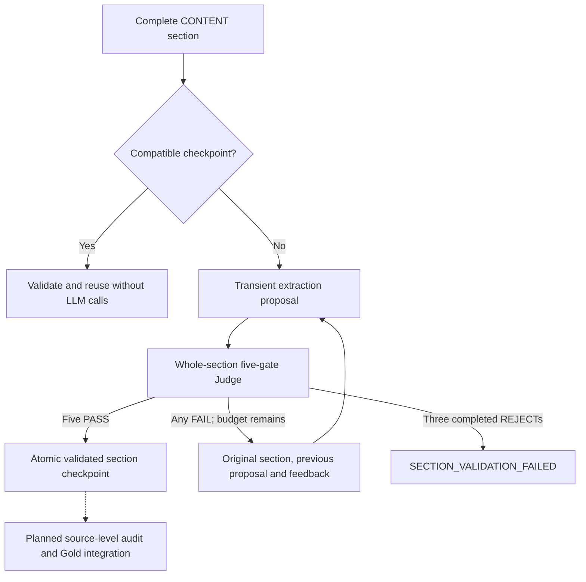

# ADR 013: Validated section knowledge checkpoints

**Status:** Accepted

## Context

[Transient extraction](012-transient-knowledge-extraction.md) proposes statements and evidence from one complete CONTENT section. Structural validity alone does not establish semantic fidelity or coverage. Reusable section-level acceptance needs a bounded quality gate and a durable checkpoint without prematurely integrating Gold or auditing an entire source.

## Decision

Judge the complete section, all current proposed items and their evidence together through exactly five binary gates: FAITHFULNESS, COMPLETENESS, ATOMICITY, CONTEXT_PRESERVATION and DUPLICATION. Application code derives PASS only from five PASS verdicts; any FAIL derives REJECT. The Judge diagnoses with actionable issues and valid item/source references; it does not rewrite final items or supply a separate overall override.

Faithfulness is material, allowing faithful paraphrasing, compression and abstraction. Atomicity preserves coherent rules with necessary conditions/reasoning rather than enforcing maximum fragmentation. Completeness concerns substantive reusable knowledge, not every sentence or filler. Cited evidence itself must support the claim. Context and within-section semantic duplication remain explicit gates; source facts and contradictions are not autonomously corrected.

After REJECT, extraction receives the original complete section, previous complete proposal and structured feedback and returns a complete replacement. The optional refinement request preserves the original standalone extraction path and statement/span-only provider output. Application code still owns section provenance and local IDs.

Permit at most three completed semantic rounds per explicit processing operation. Only a structurally valid proposal plus a structurally valid Judge evaluation consumes a round. Operational/provider/schema/resource failures abort without consuming the failed round or triggering hidden retries. Three REJECTs produce SECTION_VALIDATION_FAILED without fallback or accepted output.

After PASS, atomically publish a non-overwriting, versioned per-section ValidatedSectionKnowledge checkpoint, including exact upstream hashes, accepted items and bounded extraction/Judge round metadata. Accepted zero-item results are durable too; they remain distinct from unprocessed input, failure and upstream NO_SEGMENTABLE_CONTENT. The first compatible durable result wins despite nondeterminism. Reuse needs no provider calls; incompatible/corrupt checkpoints are never silently replaced. Model configuration changes alone do not invalidate compatibility.

## Consequences

Judge acceptance remains a model judgment, not proof of truth or complete knowledge. Successful checkpoints are reusable, but interrupted unsuccessful loops have no durable progress state. Same-section races may duplicate provider work; unique staging and atomic publication preserve the first compatible winner without deleting another operation's temporary files. Crash leftovers are ignored, never promoted automatically. Independent section paths support later bounded in-application parallelism without introducing workers, queues or source-wide orchestration.

Source-Level Audit still owns cross-section issues and final source knowledge. This decision adds no Gold identity, Markdown writer, acquisition coupling, retrieval index or distributed infrastructure. Bronze, Silver and segmentation artifacts remain immutable.
