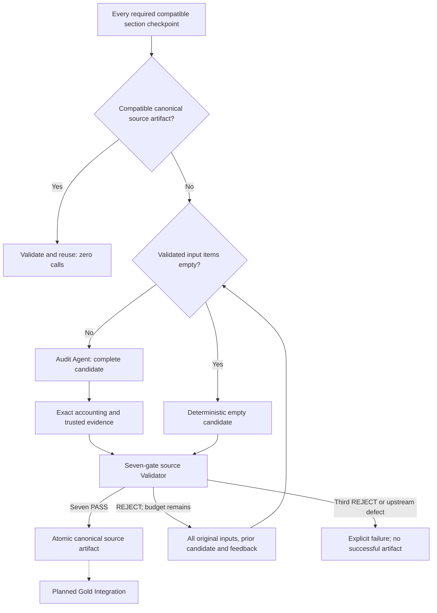

# ADR 014: Canonical one-source knowledge audit

**Status:** Accepted

## Context

[Validated section checkpoints](013-validated-section-knowledge.md) establish section-local semantic acceptance. Before later Gold integration, knowledge from all CONTENT sections of one source needs consolidation, preserved conflicts and a traceable canonical handoff.

## Decision

Require every authoritative CONTENT section to have a compatible successful checkpoint before auditing. Exclude advertisements without changing upstream artifacts. A Source Audit Agent produces a complete candidate rather than patches. Each validated input item contributes exactly once; many inputs may consolidate into one output, but no input splits or disappears. Application code assigns artifact-local identities and preserves the exact evidence union from validated contributors. No model-generated upstream provenance or new evidence is accepted.

A separate Validator evaluates exactly seven binary gates: SOURCE_FAITHFULNESS, FULL_INPUT_COVERAGE, NO_KNOWLEDGE_LOSS, CROSS_SECTION_DEDUPLICATION, COHERENCE_ATOMICITY, CONFLICT_PRESERVATION and PROVENANCE_INTEGRITY. Application code derives PASS only from seven PASS verdicts. Faithful paraphrase and coherent consolidation are allowed without losing conditions, modality, evidence or distinct knowledge. Genuine incompatible claims remain separate and explicitly flagged; the system chooses no truth winner. Missing upstream knowledge is an explicit coverage defect for review, not permission for new extraction.

REJECT returns all original inputs, the complete previous candidate and actionable feedback for complete replacement. At most three completed candidate/evaluation pairs consume semantic rounds per explicit operation. Operational failures abort without consuming the failed round or hiding retries. Three REJECTs produce SOURCE_AUDIT_FAILED with no successful artifact. Empty validated input creates a candidate deterministically, without an Audit Agent call, and still requires Validator PASS.

After PASS, atomically publish a versioned SourceKnowledgeArtifact with exact authoritative segmentation/checkpoint hashes, provenance, source-local items, contributor mappings, conflicts and bounded audit metadata. KNOWLEDGE_AVAILABLE and successful NO_SOURCE_KNOWLEDGE are explicit outcomes; empty sources retain their actual upstream segmentation outcome without placeholders. The first compatible durable artifact wins. Reuse validates schema, exact upstream state and source-audit contract, with zero provider calls. Recorded model/prompt versions are audit metadata and cannot independently invalidate compatibility. Material semantic contract changes require a contract-version change. Corrupt or incompatible artifacts are never silently replaced.

## Consequences

Semantic acceptance is a model judgment, not proof of truth or completeness. Whole-source provider capacity failures remain explicit without truncation or fallback. Compatible successful artifacts are reusable; unsuccessful-loop progress remains transient. Concurrent same-source work may duplicate provider cost, but unique owned staging and atomic non-overwriting publication preserve the first compatible winner. Crash leftovers are ignored rather than promoted or swept unsafely.

The API is independently callable and adds no acquisition coupling, automatic upstream repair, Gold identity/hierarchy, Markdown writer, cross-source integration, retrieval indexing, queue, worker or distributed infrastructure. Existing Bronze, Silver, segmentation and section-validation behavior remains unchanged.
