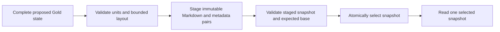

# Canonical Gold document pairs

Status: Accepted

## Context

The Gold contract separates stable knowledge identity from document placement. Readable documents need a corresponding machine representation without copying upstream artifacts or making a retrieval index authoritative. A document can contain several topics and each topic several knowledge units.

## Decision

Markdown and structured JSON metadata jointly represent each canonical document. Neither file alone is sufficient. The logical hierarchy is bounded to Entity → Document/Domain → Topic → GoldKnowledgeUnit. Generic namespace/entity/domain keys support Champion knowledge and independent concepts without an exhaustive ontology.

Document IDs use the existing `gdoc-` identity contract and survive relocation and renaming. Topic IDs are document-local organizational identifiers. Existing `gku-` identities remain semantic addresses; file paths, line numbers and headings never substitute for them. Explicit positions determine topic and unit order; duplicate positions fail.

### Pair representation

Markdown contains the document identity/version, a title, topic wrappers/headings and ACTIVE unit markers:

```markdown
<!-- gold-document:v1 id=gdoc-<32 lowercase hex> version=1 -->
# Document title

<!-- gold-topic:v1 id=topic-<32 lowercase hex> -->
## Topic title

<!-- knowledge:gku-<32 lowercase hex> -->
Literal knowledge content.
<!-- /knowledge -->

<!-- /gold-topic -->

<!-- /gold-document -->
```

The renderer applies reversible literal-text escaping. It preserves exact source strings, including Unicode composition, significant whitespace and carriage returns. Marker-like content cannot become syntax. Parsing validates the complete managed template by canonical re-rendering. This is not a general Markdown editing API.

Metadata has independent document-schema and marker-format versions, plus the existing Gold schema/contract versions. It records document identity/version, entity/domain context, topic IDs/titles/positions, unit placements and each ACTIVE unit's content hash, provenance, status and relations. ACTIVE content is recovered from Markdown. Historical MERGED records retain their complete existing Gold representation in `historical_units`.

Decoding rejects duplicate JSON keys, unknown fields, unsupported versions, invalid markers, inconsistent content hashes and mismatched document/version/topic/unit state. Local pair decoding does not establish cross-document reference closure: `validate_gold_snapshot` and the store loader validate the complete state through the existing Gold contract. Structural validity is not evidence of semantic truth. Source-reference membership can be verified separately against caller-verified upstream context.

### Empty structure and historical identities

An empty Gold snapshot with zero documents is valid. Every canonical document and topic must contain at least one ACTIVE/rendered unit. `normalize_gold_structure` operates only on explicit proposed state, removes MERGED placements and deterministically prunes empty topics/documents. Stored empty containers fail validation rather than being repaired during loading.

Historical MERGED records live in the metadata of their resolved ACTIVE survivor's document. Existing links determine that storage association; normalization does not choose survivors or flatten chains. Content, provenance, relations and original identities remain unchanged. Relations can continue to address historical IDs.

Structural pruning never deletes knowledge. Publication rejects omission of existing knowledge identities. Change Event history is outside this store and is not removed by pruning.

### Versioning

Document identity, document version, Gold schema/contract versions and marker-format version are distinct. A change to document content, title, entity/domain, topics/order, provenance, status, relations or historical membership requires a higher document version. Identical logical state retains its version. Pure physical relocation does not require a content-version increase. A pruned document is absent, not replaced with an empty version.

### Local publication

The default root is `data/gold`, overridable through `GoldConfig`. Application code owns relative routing; there are no provider-authored paths. Paths reject traversal, Windows aliases/reserved names, case-insensitive collisions and symlink/junction escape. The store assumes an application-owned local filesystem; it is not a security boundary against an actor concurrently replacing directory components.

```text
data/gold/
  CURRENT.json
  snapshots/<storage-id>/
    manifest.json
    champions/ahri/laning.md
    champions/ahri/laning.meta.json
```

The manifest records pair locations, document versions and file hashes. It is selection/integrity metadata, not a separate knowledge store. Storage IDs are not semantic identity. `GoldContractState` remains an in-memory complete-state view, with no additional canonical state JSON file.



Staging uses exclusive creation, file flushes and validation. Publication uses a small nonblocking local OS guard, verifies the expected current reference and atomically replaces the selector. Readers read the selector once. They see an old or new complete snapshot, never a half-published pair. Interrupted staging remains unselected; no directory scan guesses a winner. Identical manifests reuse the current selection. An error after selector replacement may mean the new complete state is already visible; callers reload to establish the result.

Initialization is explicit and creates an empty snapshot. Missing/corrupt selectors in populated stores fail; initialization does not repair or delete crash leftovers. Readers perform no writes. Unselected snapshots remain on disk; cleanup and historical queries are not implemented. Process-interruption tests do not establish universal power-loss guarantees for every filesystem.

## Boundaries and consequences

SourceKnowledgeArtifact → future Integration → GoldKnowledgeUnit → canonical document pairs remains the preparation boundary. A knowledge unit is not a topic, file or Retrieval document. Unresolved contradictory content stays readable while machine metadata retains explicit directional relations and provenance. Persistence does not decide a truth winner.

The APIs provide structural normalization, read-only loading and low-level staging/publication. They do not implement Integration operations, a semantic Writer, Change Events, automatic curation, retrieval, embeddings or indexes. Future coordinated Gold/Change Event publication must use staging without independently committing Gold first; its shared commit protocol remains separate work.

Whole snapshots favor auditable consistency over write efficiency. Disk usage grows with staged/published snapshots. Optional trusted application routing supports physical relocation without changing document identity. Readable literal-text encoding and strict paired validation mean arbitrary edits to only one file can invalidate canonical state; there is no automatic repair or migration.
