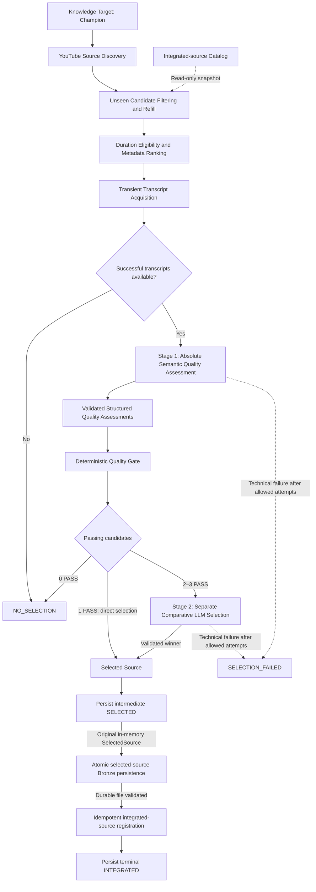
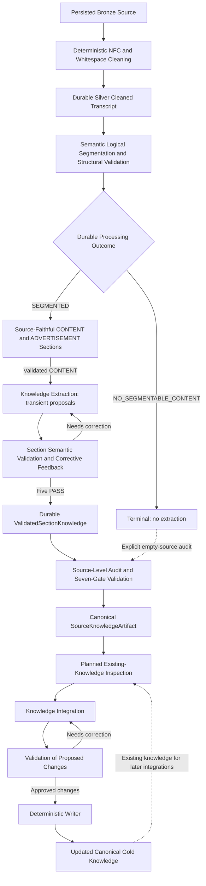
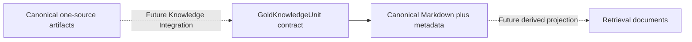
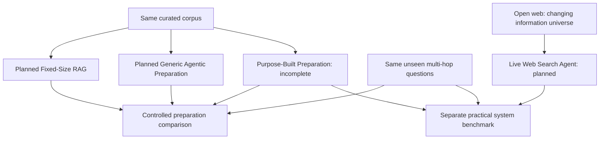

# Architecture

The Knowledge Platform is the acquisition and preparation side of an experiment on whether upstream agentic knowledge organization can reduce later multi-hop retrieval complexity and latency while preserving answer quality. League of Legends is the experimental domain. A second question tests whether preparation needs this specialized architecture or can achieve comparable results through a generic agentic harness. Both questions are open; the planned experiment supplements the accepted architecture below.

## V1 acquisition and compilation flow

The architecture has three separate views. Source Acquisition integrates selected transient sources into Bronze through resumable orchestration. Explicit deterministic Silver cleaning and semantic logical segmentation are implemented at persisted artifact boundaries. Standalone section extraction produces transient proposals, section validation publishes durable checkpoints, and source audit produces canonical one-source knowledge. Gold curation and the comparative experiment remain planned. These views preserve the existing Bronze/Silver/Gold responsibilities and local-first design.

| View | Current status |
| --- | --- |
| [Source Acquisition](#source-acquisition) | Implemented target loading, discovery, integrated-ID lookup, filtering/refill, metadata ranking, transient transcripts, absolute quality assessment, deterministic gating, conditional comparison, and run-integrated Bronze persistence/registration |
| [Agentic Knowledge Curation](#knowledge-layers-and-curator) | Implemented Silver cleaning/segmentation, extraction, validated checkpoints, source audit and Gold document storage; planned existing-knowledge inspection, semantic integration and deterministic writing |
| [Experimental Evaluation](#planned-comparative-evaluation) | Planned controlled preparation comparison plus a separate practical live Web Search benchmark |

Manually initiated sequential run orchestration is implemented through Bronze persistence and source registration, with its own SQLite progress database and immutable target snapshots. The integrated-source catalog remains separate. Run progress coordinates the existing Bronze API but remains separate from artifact storage. Curation and other future operational SQL responsibilities remain planned; the platform is not yet a completed acquisition/curation system.

## Source Acquisition

Riot Games Data Dragon establishes the authoritative Champion target universe through a committed, versioned local catalog; target loading needs no runtime Riot request. YouTube supplies the public V1 educational source pool. Its video/transcript content contains the unstructured source knowledge; discovery metadata supports candidate collection and ranking. The target catalog is not a pre-structured knowledge base.

The initial target catalog lists all Champions without enumerating Champion × Role combinations. Run orchestration attempts every original target, resumes across sessions, and integrates at most one source per target/run. The same target attempt passes its selected source directly to Bronze and completes only after registration. A Champion is never permanently complete. Role-specific and reusable general knowledge can emerge from content; systematic general-concept acquisition remains future scope.

For each target, collection seeks 20 unique unseen candidates and returns at most 20, refilling after integrated-ID filtering and cross-page deduplication until enough are found or search is exhausted. Normal absence of a usable source is a persisted `NO_SELECTION`, not a technical failure. Duration is an eligibility filter only; popularity/recency ranking returns up to three candidates. Available English transcripts are acquired transiently, retaining original candidate identity and segment timing/provenance. Technical transcript-acquisition errors abort that target attempt before source selection; later Champions can continue.

The implemented semantic stages are separate capabilities behind a provider-independent interface, with a DeepSeek adapter. Explicit allowlists serialize only target ID/name and video IDs/full transcript texts in canonical video-ID order. Neither stage receives popularity, recency, ranking scores, discovery order, channel popularity, or original shortlist rank. Both use complete available transcripts without silent truncation, summarization, or semantic pre-filtering.

**Stage 1 — absolute assessment:** Each transcript is assessed independently for target relevance, educational substance, usability, and whether noise dominates. Validated structured attributes enter application code. The rule is `target_relevant AND educational_substance AND transcript_usable AND NOT noise_dominates`. Thus **LLM semantic judgement → structured assessment → deterministic application rules → PASS / REJECT**. Semantic judgments themselves are not guaranteed deterministic or correct.

**Branching:** Zero acquired transcripts produces normal `NO_SELECTION` without an LLM call. After the quality gate, zero PASS also produces `NO_SELECTION`; one PASS selects that source directly; two or three PASS invoke Stage 2.

**Stage 2 — relative comparison:** Only passing transcripts are compared for target relevance, educational usefulness, information density, clarity/explanatory value, useful breadth/depth, and noise. Fresh request objects and messages exclude Stage-1 assessments, booleans, codes, and rationales. The chosen ID and complete assessment coverage are validated against the passing set. No weighted numeric formula is introduced.

Each semantic stage permits at most three total attempts for recoverable failures or invalid output, reusing unchanged inputs. Unrecoverable errors fail explicitly without consuming unnecessary retries. Technical inability to complete selection yields `SELECTION_FAILED`, not `NO_SELECTION` or a fallback winner. A Stage-2 failure does not repeat successful quality assessment or restart acquisition. All results, assessments, and transcripts remain transient. Only a successfully selected source is eligible for the Bronze integration API; it does not itself persist or register a source. See the [selection API overview](../README.md#source-quality-assessment-and-selection).

## Knowledge layers and curator

Bronze persistence is implemented and invoked directly by acquisition runs. A separate [Silver cleaning API](../README.md#silver-transcript-cleaning) reads canonical Bronze, applies only NFC/whitespace normalization and publishes a versioned canonical cleaned transcript. It preserves every existing segment's index, order and timing, including segments whose cleaned text is empty. No semantic advertisement/noise removal, synthesis or logical segmentation occurs. No provider calls or database changes are needed; acquisition-run orchestration does not invoke cleaning automatically.

Silver includes source, acquisition and track metadata, plus the canonical relative Bronze reference and SHA-256 of the exact input bytes. Strict validation and material comparison make compatible repeats byte-preserving; conflicts fail without replacement. Schema and cleaning-rule versions are explicit. Runtime Unicode version is diagnostic provenance only and cannot independently reject equivalent content. Future material normalization changes require an explicit cleaning-rule version change. Staging and non-overwriting atomic publication reuse the local filesystem mechanisms; Bronze remains read-only.

The separate [semantic segmentation API](../README.md#semantic-silver-segmentation) is the single SEGMENT stage. An LLM proposes contiguous boundaries over indivisible Silver segments and only CONTENT/ADVERTISEMENT kinds. Deterministic validation checks complete exactly-once ordered coverage, permitting inherited index gaps and caption overlaps. Application code derives section text, member provenance and enclosing timing from all members. Clear ads are retained; mixed or ambiguous substantive material remains CONTENT. No titles, summaries, content rewriting or semantic section-size rules are introduced. Structural validation does not prove semantic coherence or classification accuracy.

One application-owned budget permits at most three capability invocations, including transport and invalid-response failures, with concrete structural feedback and no HTTP retries. Full-source requests never fall back to fixed-size or technical-window segmentation. Non-overwriting atomic persistence records SEGMENTED or deterministic NO_SEGMENTABLE_CONTENT with zero sections/calls. Compatible canonical results are reused without inference; corrupt/incompatible results fail without overwrite. Original Silver/Bronze bytes remain unchanged. Exact Silver hash/reference, original indices/timing, upstream provenance and bounded provider/model/prompt/attempt metadata are retained. These explicit local APIs do not add automatic acquisition-to-preparation orchestration or async workers.

The standalone [Knowledge Extraction API](../README.md#transient-knowledge-extraction) now implements EXTRACT for one complete validated CONTENT section. It reconstructs member texts from the exact referenced Silver input, while retaining indices, timing and upstream hashes. The model returns only statements and spans; application code checks current-section bounds, attaches trusted section identity and assigns local item IDs. One invocation produces transient ITEMS_PROPOSED or NO_KNOWLEDGE_PROPOSED. Neither outcome is semantically accepted, canonical or persisted. Deterministic schema/reference checks do not establish semantic grounding, completeness or duplicate-free knowledge. Advertisements are rejected before provider calls and remain durable upstream; NO_SEGMENTABLE_CONTENT supplies no extraction unit. No semantic retry loop, source orchestration or upstream mutation is introduced.

The separate [section-validation API](../README.md#section-level-semantic-validation) now judges one complete section, all items and their cited evidence through five binary gates. Application code derives PASS only from five PASS verdicts. Rejection supplies actionable structured feedback for complete re-extraction; at most three completed valid proposal/Judge pairs consume semantic rounds, with no hidden retries. Operational failures abort without consuming the failed round. Zero-item proposals receive the same full-section Completeness review. PASS publishes a versioned durable per-section checkpoint, including accepted-empty results, with exact upstream references and compact round/model metadata. Compatible first durable results are reused without LLM calls; corrupt/incompatible results are never silently replaced. Standalone extraction stays transient and single-invocation. See the [validated-section decision](adr/013-validated-section-knowledge.md).

The separate [source-audit API](../README.md#source-level-audit-and-refinement) loads the authoritative CONTENT set and every compatible successful section checkpoint before processing. An Audit Agent consolidates a complete candidate with exactly-once contributor accounting. Application code attaches trusted evidence and lineage; a separate seven-gate Validator checks fidelity, coverage, retained meaning, deduplication, coherent units, preserved conflicts and provenance. REJECT supplies feedback for complete replacement within at most three completed semantic rounds. Provider/schema/resource failure aborts without a failed round; upstream coverage defects escalate rather than triggering extraction. Empty inputs construct a candidate without the Agent but still require Validator PASS. Successful KNOWLEDGE_AVAILABLE or NO_SOURCE_KNOWLEDGE artifacts retain exact upstream hashes, local identities and bounded round metadata. Schema, exact upstream state and audit-contract version govern reuse; recorded model/prompt versions are metadata. See the [source-audit decision](adr/014-source-knowledge-audit.md).

Existing-Gold inspection, Knowledge Integration and a Deterministic Writer remain planned. SourceKnowledgeArtifact is canonical knowledge for one source, not integrated Gold. Same-section/source races may duplicate provider work but atomic publication preserves one compatible winner; owned staging cleanup never deletes another operation's file. Failed-loop progress is not durably resumed, and no automatic preparation orchestration or worker infrastructure is introduced. Integration will inspect existing Gold and propose governed changes; deterministic code will apply validated, approved changes. See [planned curation](../README.md#planned-agentic-knowledge-curation).

| Component | Responsibility | Durable output |
| --- | --- | --- |
| Bronze | Retain only the admitted source's raw transcript and available provenance. | Selected source material and source identity. |
| Silver | Deterministic NFC/whitespace cleaning followed by the single semantic boundary/kind proposal and deterministic partition validation. | Versioned cleaned transcripts and durable logical-section/empty outcomes, preserving source content and provenance. |
| Knowledge Curator | Process one Silver source at a time after inspecting relevant existing Gold knowledge. | Governed changes or a recorded no-change outcome. |
| Gold | Maintain current structured League knowledge in an adaptive, versioned Markdown Knowledge Wiki. | Canonical knowledge with provenance and visible contradictions. |

### Gold contract and canonical document persistence

The implemented [Gold contract API](../README.md#versioned-gold-contract) provides immutable structural models and a pure versioned codec. SourceKnowledgeArtifact contains accepted knowledge from one source; GoldKnowledgeUnit has global identity and can reference multiple contributing source items. A Gold unit is distinct from a Markdown file, topic and Retrieval document. Future Integration decides synthesis and changes. The separate [document API](../README.md#canonical-gold-documents) renders, validates and persists canonical Markdown plus structured metadata without implementing those semantic decisions.

Knowledge IDs are independent of text, paths, topics and embeddings. Complete-state validation detects duplicate active/historical IDs and dangling relations/survivors. ACTIVE and MERGED records retain content and source-item provenance; explicit merged links resolve through finite chains without choosing a survivor or rewriting historical IDs/relations. Minimal `related_to` and `contradicts` edges can retain unresolved disagreements without automatic winners. Schema/contract compatibility and document versions are separate from identity.

Gold source references retain source identity, a relative locator, exact-byte hash, upstream versions and artifact-local item ID. Structural validation is separate from checking reference membership in caller-verified source context; neither proves semantic truth. Upstream source readers own evidence validation. Deterministic UTF-8 interchange preserves content and sorts collections while rejecting duplicates, malformed fields and unsupported Gold versions. The contract carries no fixed ontology or vector state. Documents group units through bounded Entity → Document/Domain → Topic organization, and later Retrieval can preserve that context as optional-depth metadata.

Markdown and metadata are jointly canonical. ACTIVE content is marked by stable knowledge IDs; metadata records exact hashes, placements, provenance and relations. Document IDs survive relocation independently of versions. Changed logical documents require increased versions. Empty Gold is valid, but every canonical document/topic contains ACTIVE units. Pure normalization prunes empty containers while retaining full historical MERGED records in the resolved survivor document's metadata. It does not merge units or delete knowledge/history.

The local store stages complete immutable snapshots, validates all pairs and global references, then atomically selects one through `CURRENT.json` under a minimal local publication guard. Read-only loaders pin that selection. The manifest is integrity/routing metadata, not a second knowledge database. Unselected leftovers are ignored; corruption and stale bases fail explicitly. Future Gold/Change Event coordination must use unselected staging and its own shared commit boundary. IntegrationPlan, semantic writing, events, retrieval and automatic orchestration remain planned. See [canonical-document decision](adr/015-canonical-gold-documents.md).

The curator may apply NO_CHANGE, ENRICH, REWRITE, CREATE, MERGE, LINK, or FLAG_CONFLICT. It favors enriching equivalent knowledge over duplication and does not autonomously DELETE knowledge in V1. Source and operational metadata in Bronze and Silver remain deterministic; this restriction does not prevent semantic knowledge in Gold or transcript-based LLM source selection.

## Local state and retrieval boundary

The implemented SQLite catalog stores only integrated source IDs and their registration timestamps. Registration is idempotent and follows successful persistence by the Bronze integration API; the catalog does not implement Bronze itself. Collection reads a fixed integrated-ID snapshot and does not persist transient candidates.

The [Bronze API](../README.md#selected-source-bronze-integration) stores one versioned source-centric JSON artifact per case-sensitive video ID, using a reversible filename encoding for Windows compatibility. It retains the original source/transcript and first-integration target/run/winner provenance. Sibling staging, flushing, validation and non-overwriting publication precede catalog registration. Compatible retries reuse the original bytes, including after a crash between publication and registration. Later contextual provenance does not independently conflict or mutate Bronze; materially different source/transcript content fails explicitly. Bronze owns no event-history tables, provenance sidecars, Silver transformations or run-state transitions. Run orchestration separately projects successful integration into its own database.

**Selected and integrated are distinct states.** The run service persists selection before handing the in-memory source to Bronze; registration follows validated durable persistence. In the intended repeated-run flow, successful persistence/registration of A allows later collection to exclude A and seek B for the same Champion; after B is also integrated, another collection excludes both while seeking C. Run orchestration invokes the Bronze API directly and persists `INTEGRATED` only after that operation succeeds. Rejected or losing candidates are not registered by acquisition.

The run service exposes explicit new/resume operations. Its separate SQLite database stores `acquisition_runs` and `acquisition_run_targets`; it has no write path into `integrated_sources`. Creation atomically copies catalog/version provenance and each Champion's ID, key, name and order, with an immutable count and canonical snapshot hash. SQL constraints/triggers protect the original target universe. Resume reconstructs that universe from stored rows and never loads a current or historical external catalog file.

```mermaid
stateDiagram-v2
    [*] --> PENDING
    PENDING --> RUNNING: Commit attempt count + 1
    RUNNING --> SELECTED: Persist successful selection
    RUNNING --> NO_SELECTION: Normal domain outcome
    RUNNING --> FAILED: Technical failure or interruption
    SELECTED --> INTEGRATED: Bronze and registration succeeded
    SELECTED --> FAILED: Integration failed or payload lost
    SELECTED --> RUNNING: Claim registration recovery
    FAILED --> RUNNING: Claim bounded full or registration attempt
    FAILED --> INTEGRATED: Passive proof of durable integration
    RUNNING --> INTEGRATED: Registration-only recovery succeeded
    INTEGRATED --> [*]
    NO_SELECTION --> [*]
    FAILED --> [*]: Exhausted at count 3
```

The attempt-start commit precedes external calls; every persistence transaction is short. Existing component retries stay internal to their component. A local OS execution guard rejects overlapping invocations without holding SQL locks during provider calls; it has no lease or heartbeat. After a crash, persisted `ACTIVE`/`RUNNING` is stale until explicit inspection/resume recovers it. Recovery records `FAILED / ORCHESTRATION / INTERRUPTED` without increasing the already consumed attempt count. Each invocation makes one pass; failed targets below three attempts wait for another explicit resume. Integrated and normally unselected targets are skipped. Selected identities on unresolved/exhausted work are reconciled before any acquisition retry.

Run summaries derive counts from the original stored targets. Retryable work leaves `RESUMABLE`; all `INTEGRATED`/`NO_SELECTION` outcomes yield `COMPLETED`; terminal exhausted failures yield `COMPLETED_WITH_FAILURES`. Target failures do not prevent later Champions, while unsafe persistent-state failures abort explicitly. A valid canonical Bronze artifact plus existing registration repairs stale selected state without another attempt or registration call. Missing registration requires a newly committed registration-only attempt; missing Bronze requires a newly committed full attempt. Both share the maximum of three. Passive repair remains possible after exhaustion, while corrupt/incompatible Bronze aborts explicitly without rediscovery. Only minimal selection identity/method, outcome/failure codes and timestamps are persisted; transcripts remain outside run-state storage. The original in-memory selected source passes directly to Bronze with the stored run/target context. Run schema v2 is initialized explicitly; v1 requires a validated backup and atomic one-step migration. Legacy selections remain unresolved and retain their budgets/snapshots. See [run API and recovery](../README.md#resumable-acquisition-runs) and [migration](../README.md#explicit-run-state-migration).

Additional sources may create or enrich knowledge, overlap with existing knowledge, expose conflicts, or yield `NO_CHANGE` in planned curation. Gold evolves through governed integration with existing knowledge rather than a separate rebuild for every source. These are intended integration outcomes, not implemented curation or guaranteed marginal knowledge gain.

Run progress and per-target acquisition results are implemented. Wider operational SQL responsibilities, including raw knowledge-change counts and Gold index synchronization state, remain planned. Raw counts will support comparison of marginal knowledge gain across repeated runs; V1 has no synthetic aggregate score or automatic stop threshold. Schemas for those additional responsibilities remain future technical design work.

The planned local retrieval/vector index serves the Gold Wiki but is not authoritative. Changed Gold documents are re-chunked and re-embedded, their vectors are upserted, stale vectors are removed where applicable, and synchronization state is updated. A full rebuild after each curation run is not required. No vector database product is mandated.

The V1 design runs locally with filesystem Bronze/Silver/Gold artifacts and local operational and retrieval stores. External source/search and LLM APIs are used where needed. Azure infrastructure and Azure AI Search are not V1 requirements; Azure remains a possible later deployment direction.

## Planned comparative evaluation

The research separates the value of upstream preparation from the value of a specialized preparation architecture. Neither is established. The following view supplements Source Acquisition and Knowledge Preparation; it does not change their approved contracts or claim a completed experiment.

| Planned system | Preparation and role |
| --- | --- |
| Purpose-Built Agentic Knowledge Preparation | This repository's complete custom system: unstructured sources → acquisition → Bronze → cleaned Silver → semantic segmentation → extraction → semantic validation → source audit → cross-source Gold integration → canonical Gold → downstream retrieval/answering. The complete system is not yet implemented. |
| Fixed-Size RAG | Conventional fixed-size chunking and standard retrieval over the same controlled source corpus; a simple preparation baseline. |
| Generic Agentic Preparation | A capable general-purpose agent receives the same controlled corpus and a broad knowledge-base-building objective. It may inspect sources, organize/update documents, consolidate information and improve its knowledge base iteratively. It does not receive this project's specialized contracts or preparation architecture. Hermes is a candidate harness, not a mandatory dependency. |
| Live Web Search Agent | A capable agent answers the same evaluation questions using live web search, without a dedicated prepared knowledge base. |

| Comparison group | Planned systems | Purpose |
| --- | --- | --- |
| Controlled knowledge-preparation comparison | Fixed-Size RAG; Generic Agentic Preparation; Purpose-Built Agentic Knowledge Preparation | Isolate preparation strategy using the same curated source corpus and the same previously unseen multi-hop questions. |
| Practical system-level benchmark | Purpose-Built Prepared Knowledge System; Live Web Search Agent | Test the practical value of maintaining prepared knowledge versus searching the open web at query time. This is not a controlled preparation ablation. |

Where possible, the later controlled comparison should hold the answering model, questions, source corpus and applicable downstream retrieval infrastructure constant. The generic preparation agent must not inherit the custom KnowledgeItem contract, section-validation gates, exact source-audit lineage accounting, IntegrationPlan or specialized Gold integration rules: doing so would reproduce the architecture under test.

Live Web Search changes the available information universe, source selection, retrieval mechanism, freshness and potentially source quality. It is a practical system-level benchmark and must be analyzed separately from the controlled same-corpus comparisons.

| Workstream | Priority and scope |
| --- | --- |
| A — Core Knowledge System | Current priority: complete Source → canonical Gold integration. Acquisition, source preparation, the Gold contract and canonical document storage exist; semantic Gold integration and Change Events remain planned. |
| B — Retrieval / Answering | Later: build the serving/query-time path over canonical Gold. Retrieval remains derived/rebuildable and is not implemented. |
| C — Baselines | Later: Fixed-Size RAG, Generic Agentic Preparation and Live Web Search Agent, with the purpose-built system as the system under test. No baseline system is implemented. |
| D — Experimental Evaluation | Later: evaluation dataset → ground truth / required evidence → experiment configuration freeze → runs → metrics → analysis. No comparative results exist. |

Answer quality/groundedness, evidence retrieval, query-time latency/tool/reasoning effort and preparation effort are candidate measurement areas, not a frozen protocol or reported results. Existing raw knowledge-gain requirements are preserved.

The later Baseline / Evaluation design freeze will decide chunk size and overlap; embedding model and vector store; reranking; Web Search provider/tool; generic-agent harness and prompts; tool/token budgets and search-call limits; evaluation questions and ground-truth/required-evidence construction; metric definitions and weighting; statistical tests and repetitions; and latency/cost measurement protocol. None is fixed by this framing update.

See the [research questions](../README.md#research-questions) and [evaluation overview](../README.md#experimental-evaluation).

## System context and decisions

The separate Voice Coach can later retrieve Gold knowledge and reason over the player's manually supplied game context while maintaining current-game session state. A separate evaluation system can assess retrieval and coaching quality as well as repeated-run knowledge gain. Automatic patch awareness, live game-state reading, and persistent cross-game memory are outside initial V1.

The decisions and superseded assumptions are recorded in the public ADRs: [medallion layers](adr/001-medallion-architecture.md), [Silver source alignment](adr/002-source-aligned-chunks.md), [superseded Azure index](adr/003-single-search-index.md), [source metadata](adr/004-minimal-deterministic-metadata.md), [local-first V1](adr/005-local-first-v1.md), [iterative acquisition](adr/006-iterative-champion-acquisition.md), [source selection](adr/007-two-stage-source-selection.md), [canonical Gold](adr/008-canonical-gold-wiki.md), [operational state](adr/009-local-state-and-knowledge-gain.md), [incremental retrieval](adr/010-incremental-gold-retrieval-index.md), and [semantic Silver segmentation](adr/011-semantic-silver-segmentation.md).

The source-selection ADR records the metadata-to-semantic funnel. The semantic portion now has its own absolute-assessment and conditional comparative stages, detailed above. The ADR history remains intact; these details do not replace its acquisition, provenance, or selected-source boundaries.
